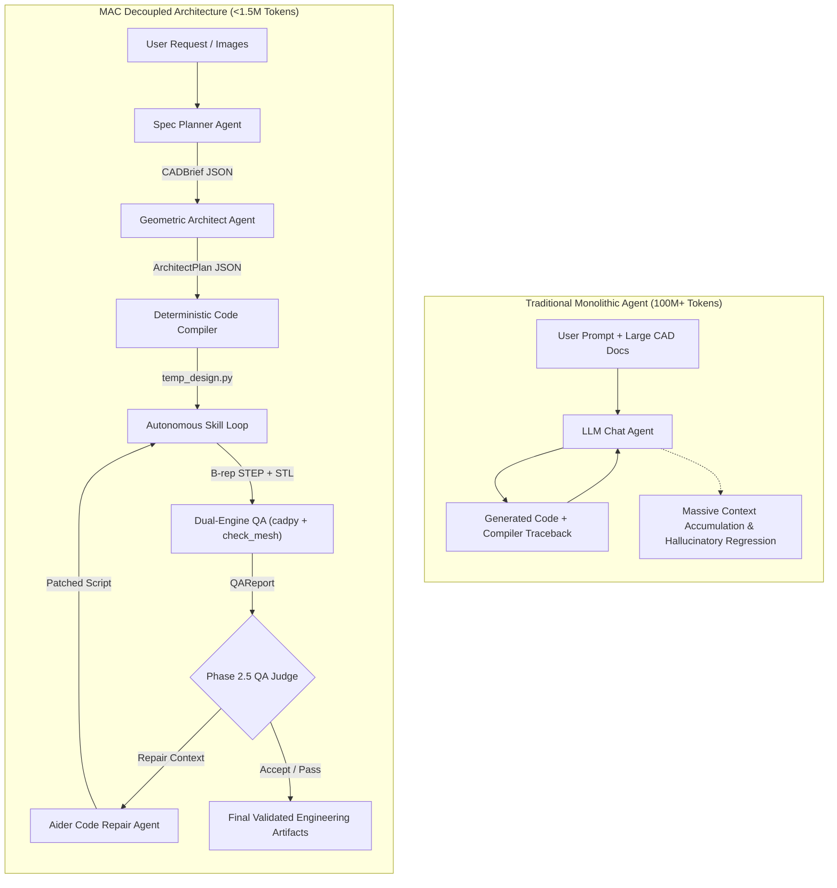
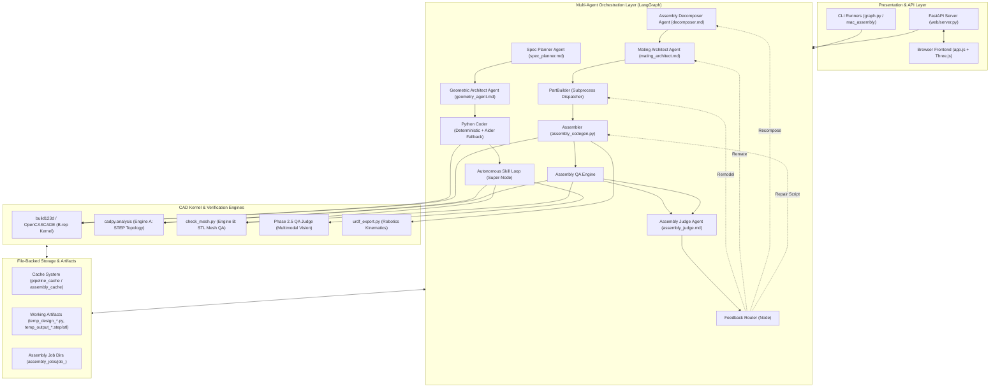
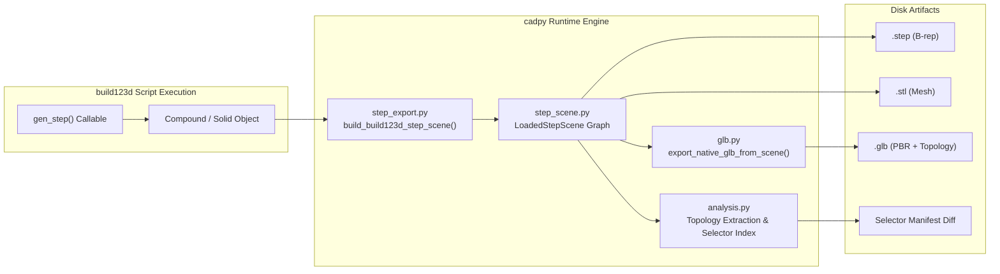
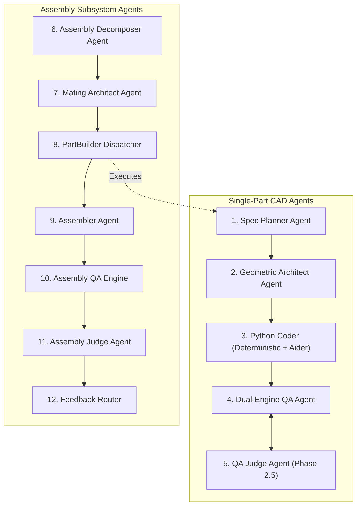
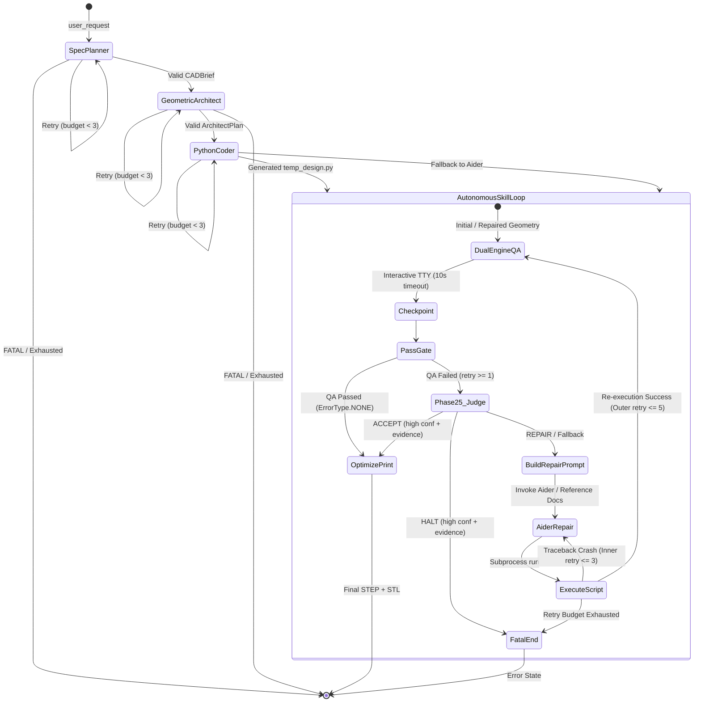
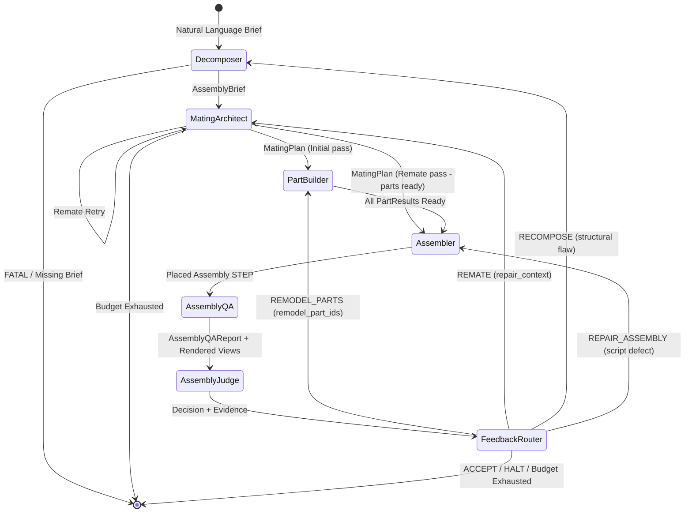
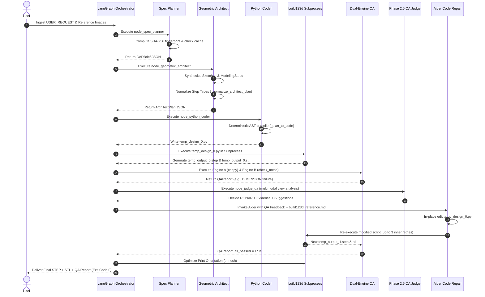
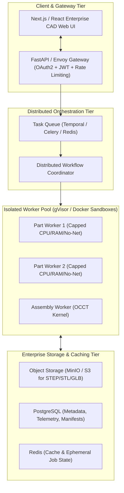

# System Architecture & Technical Design Document: Multi-Agent CAD (MAC)

> **Repository**: [Multi-Agent-CAD](file:///C:/Users/shiva/Downloads/Multi-Agent-CAD-main/Multi-Agent-CAD-main)  
> **Authors**: Tsinghua University, College AI, IEI Lab  
> **Core Focus**: Text-to-CAD Generation for Standalone Engineering Parts, Multi-Part Assemblies, and Robotics URDF Mechanisms  
> **Target Audience**: AI Systems Engineers, CAD Automation Researchers, Multi-Agent System Architects  
> **Document Status**: Production-Grade Reverse-Engineered Architecture Specification (HLD & LLD)

---

## Table of Contents

1. [Executive Summary & Architectural Philosophy](#1-executive-summary--architectural-philosophy)
2. [Technology Stack & Runtime Dependencies](#2-technology-stack--runtime-dependencies)
3. [High-Level Design (HLD)](#3-high-level-design-hld)
4. [Low-Level Design (LLD): Single-Part CAD Subsystem (`multi_agent_cad`)](#4-low-level-design-lld-single-part-cad-subsystem-multi_agent_cad)
5. [Low-Level Design (LLD): Multi-Part Assembly Subsystem (`mac_assembly`)](#5-low-level-design-lld-multi-part-assembly-subsystem-mac_assembly)
6. [Low-Level Design (LLD): CAD Engine & STEP Runtime (`packages/cadpy`)](#6-low-level-design-lld-cad-engine--step-runtime-packagescadpy)
7. [Multi-Agent Architecture & Agent Catalog](#7-multi-agent-architecture--agent-catalog)
8. [Orchestrator Architecture, Control Flow & State Machines](#8-orchestrator-architecture-control-flow--state-machines)
9. [End-to-End Execution Pipelines: Complete Step-by-Step Trace](#9-end-to-end-execution-pipelines-complete-step-by-step-trace)
10. [API Architecture & Frontend-Backend Communication](#10-api-architecture--frontend-backend-communication)
11. [Storage, Artifact Lifecycle & Cache Architecture](#11-storage-artifact-lifecycle--cache-architecture)
12. [CAD Kernel Integration, Parametric Modeling & Execution Isolation](#12-cad-kernel-integration-parametric-modeling--execution-isolation)
13. [Architectural Evaluation: Strengths, Technical Debt & Vulnerabilities](#13-architectural-evaluation-strengths-technical-debt--vulnerabilities)
14. [Implementation Status Matrix](#14-implementation-status-matrix)
15. [Target Architecture & Phased Implementation Roadmap](#15-target-architecture--phased-implementation-roadmap)

---

## 1. Executive Summary & Architectural Philosophy

### 1.1 Mission & Capabilities
**MAC (Multi-Agent CAD)** is a decoupled, state-driven multi-agent framework designed to synthesize editable, manufacturing-grade 3D Computer-Aided Design (CAD) models directly from unconstrained natural-language design briefs and reference imagery. Unlike conventional generative approaches that output non-parametric meshes, point clouds, or signed distance fields (SDFs), MAC produces deterministic **Boundary Representation (B-rep)** models exported to standard engineering exchange formats:
- **STEP (ISO 10303-21)**: Exact mathematical B-rep topology (faces, edges, vertices, NURBS, analytical surfaces) for CNC machining, injection molding, and parametric CAD import.
- **STL (Standard Tessellation Language)**: High-resolution triangulated meshes for additive manufacturing (3D printing).
- **GLB (glTF 2.0 Binary)**: Physically-Based Rendering (PBR) assets embedded with topological face/edge metadata for interactive web rendering.
- **URDF (Unified Robot Description Format)**: Articulated kinematic trees with inertial tensors, joint limits, and collision geometry for physics and robotics simulation (PyBullet, MuJoCo, Isaac Sim).

### 1.2 Core Architectural Axiom: Information Compression over Conversational History
A fundamental limitation of traditional conversational LLM coding agents (e.g., standard ReAct or chat loops) is context bloat. As an agent iterates, conversation history accumulates raw system prompts, large CAD API manuals, intermediate Python scripts, terminal outputs, and traceback exceptions. This causes quadratic token consumption, severe context dilution, and hallucinatory regressions.

MAC solves this through **Information Compression**:
1. **Decoupled Specialized Agents**: Reasoning is factored into distinct cognitive stages: requirement extraction (`Spec Planner`), geometric synthesis (`Geometric Architect`), algebraic code translation (`Python Coder`), and closed-loop verification (`Autonomous Skill Loop`).
2. **Compact Structured Pydantic Contracts**: Agents do not exchange raw prose or chat histories. They exchange strict, validated Pydantic JSON schemas (`CADBrief`, `ArchitectPlan`, `QAReport`). A 2,000-token prompt is compressed into a 50-field `CADBrief`, which is refined into an `ArchitectPlan`, reducing token consumption by over **98%** compared to monolithic single-agent loops.
3. **Deterministic Translation First**: Standard geometric primitives (extrusions, holes, revolves, patterns, fillets) are compiled directly into [build123d](file:///C:/Users/shiva/Downloads/Multi-Agent-CAD-main/Multi-Agent-CAD-main/multi_agent_cad/_node_codegen.py) Python code via an internal AST/algebra compiler at **zero LLM token cost**. LLMs (via [Aider](https://aider.chat/)) are invoked only for complex, non-regular features or corrective repair.
4. **Dual-Engine Closed-Loop Verification**: Geometry is not judged by visual appearance alone. MAC validates geometry through two complementary engines:
   - **Engine A (Deterministic)**: OpenCASCADE topological inspection via `cadpy.analysis` on the `.step` B-rep.
   - **Engine B (Heuristic)**: Physical mesh analysis via `legacy_refs/check_mesh.py` and `trimesh` on the `.stl` triangulation (Union-Find manifold connectivity, watertightness, wall thickness, hole clustering).
5. **Phase 2.5 Multi-Modal QA Judge with 5-Layer Anti-Hallucination Gate**: An independent LLM evaluator inspects structured error telemetry and rendered multi-view isometric projections to override false-positive QA failures, halt impossible specifications, or inject targeted repair guidance.



---

## 2. Technology Stack & Runtime Dependencies

The complete dependency tree, runtime environments, and language configurations are codified in [pyproject.toml](file:///C:/Users/shiva/Downloads/Multi-Agent-CAD-main/Multi-Agent-CAD-main/pyproject.toml), [environment.yml](file:///C:/Users/shiva/Downloads/Multi-Agent-CAD-main/Multi-Agent-CAD-main/environment.yml), and [requirements.txt](file:///C:/Users/shiva/Downloads/Multi-Agent-CAD-main/Multi-Agent-CAD-main/requirements.txt).

| Layer | Technology | Version Constraint | Operational Role |
| :--- | :--- | :--- | :--- |
| **Runtime Language** | Python | `>=3.11, <3.13` | Core execution runtime. Python 3.11 is the primary certified version. |
| **Agent Orchestration** | LangGraph | `>=0.2, <0.3` | Stateful directed graph execution, state transitions, conditional edges. |
| **State Persistence** | LangGraph Checkpoint | `>=2.0, <3.0` | In-memory and disk-based state machine checkpointing. |
| **Data Contracts** | Pydantic | `>=2.5` | Type validation, serialization, schema enforcement, default coercion. |
| **CAD Kernel** | build123d | `>=0.8, <0.13` | Algebraic 3D B-rep CAD modeling built on OpenCASCADE Technology (OCCT). |
| **OCCT Bindings** | cadquery-ocp / cadquery-ocp-novtk | `7.7.x` (transitive) | Low-level C++ OpenCASCADE wrapper. Constrained to `<0.13` because build123d 0.13 upgrades to OCP 8.x which breaks the vendored `cadpy` runtime. |
| **Code Repair Agent** | aider-chat | `==0.82.3` | Automated LLM-driven Git/AST code editing, in-place file refactoring. Installed via `--no-deps` to bypass upstream `numpy==1.26.4` conflict. |
| **LLM Gateway** | openai | `>=1.20.0` | OpenAI-compatible client used to interface with Alibaba DashScope (Qwen), OpenRouter, Gemini, DeepSeek, or local Ollama. |
| **LLM Gateway (Secondary)**| anthropic | `>=0.30` | Optional Claude fallback provider interface. |
| **LLM Proxy / Router** | litellm | Transitive (via aider) | Unified completion interface utilized internally by Aider. |
| **Mesh Analysis Engine** | trimesh | `>=4.0` | STL triangular mesh validation, inertia calculation, ray-tracing containment, watertightness checks. |
| **Spatial Indexing** | rtree | `>=1.1` | R-tree spatial index used by Trimesh for fast collision and ray queries. |
| **Scientific Computing** | numpy, scipy, scikit-learn | `numpy>=1.24,<2.3`, `scipy>=1.10`, `scikit-learn>=1.3` | Vector transformations, k-d tree spatial clustering (cKDTree in `check_mesh.py`), SVD, inertial tensor diagonalization. |
| **Headless Visualization** | matplotlib | `>=3.8` | Off-screen isometric rendering via `Poly3DCollection` and `Line3DCollection` (Agg backend) for multi-modal QA. |
| **Image Processing** | Pillow (PIL) | `>=10.0` | Loading, aspect-ratio scaling, and JPEG encoding of reference images. |
| **Web Gateway** | FastAPI, Uvicorn | `fastapi>=0.110`, `uvicorn[standard]>=0.27` | Asynchronous REST API, Server-Sent Events (SSE) streaming, static file serving. |
| **Frontend Viewer** | Three.js | `r128` (CDN) | Browser-based WebGL interactive 3D orbit viewer for generated GLB models. |
| **Simulation Export** | defusedxml / xml.etree | Standard Library | XML construction of robot description kinematics (URDF format). |

### 2.1 Dependency Isolation & Native Constraints
- **NumPy / Aider Packaging Conflict**: `aider-chat 0.82.3` declares an overly strict pin `numpy==1.26.4`, whereas `build123d >=0.8` requires `numpy >=2.0, <3.0`. The project resolves this by installing `aider-chat` via `pip install --no-deps aider-chat==0.82.3` and forcing `numpy>=2.0,<2.3`. Runtime tests confirm Aider functions properly under NumPy 2.x.
- **Vendored CAD Engine (`packages/cadpy`)**: `packages/cadpy` is not an external PyPI package; it is an in-repo vendored runtime derived from [earthtojake/text-to-cad](https://github.com/earthtojake/text-to-cad). It is dynamically injected into `sys.path` at runtime by [nodes.py](file:///C:/Users/shiva/Downloads/Multi-Agent-CAD-main/Multi-Agent-CAD-main/multi_agent_cad/nodes.py#L960) and [_cadpy_runner.py](file:///C:/Users/shiva/Downloads/Multi-Agent-CAD-main/Multi-Agent-CAD-main/multi_agent_cad/_cadpy_runner.py#L75).

---

## 3. High-Level Design (HLD)

MAC is organized into four interconnected subsystems:
1. **Single-Part Multi-Agent CAD Pipeline (`multi_agent_cad`)**: Implements the sequential planning, deterministic code compilation, and iterative closed-loop repair for individual solid components.
2. **Multi-Part Assembly Framework (`mac_assembly`)**: A technology preview that decomposes complex mechanisms into hierarchical parts, computes topological kinematic mates, manages component reuse/mirroring, executes per-part builders in isolated subprocesses, and exports assembled CAD and URDF robot trees.
3. **Low-Level Geometry & STEP Scene Engine (`packages/cadpy`)**: Provides B-rep analysis, selector DSL parsing, STEP scene assembly, GLB Draco tessellation, PBR material synthesis, and metadata embedding.
4. **Web UI & API Gateway (`multi_agent_cad/web`)**: A secure FastAPI server providing non-blocking execution, real-time Server-Sent Events (SSE), and interactive Three.js 3D visualization.



---

## 4. Low-Level Design (LLD): Single-Part CAD Subsystem (`multi_agent_cad`)

The single-part pipeline transforms natural-language prompts and optional reference imagery into a validated STEP/STL model.

### 4.1 Subsystem File Organization
- [config.py](file:///C:/Users/shiva/Downloads/Multi-Agent-CAD-main/Multi-Agent-CAD-main/multi_agent_cad/config.py): User-configurable hyper-parameters, API endpoints, per-stage LLM models, retry budgets, and timeouts.
- [schemas.py](file:///C:/Users/shiva/Downloads/Multi-Agent-CAD-main/Multi-Agent-CAD-main/multi_agent_cad/schemas.py): Strict Pydantic models defining data schemas: `CADBrief`, `ArchitectPlan`, `QAReport`, `JudgeDecision`, and `GraphState`.
- [graph.py](file:///C:/Users/shiva/Downloads/Multi-Agent-CAD-main/Multi-Agent-CAD-main/multi_agent_cad/graph.py): LangGraph state graph wiring `planner -> architect -> coder -> autonomous_skill_loop -> END`.
- [graph_aider.py](file:///C:/Users/shiva/Downloads/Multi-Agent-CAD-main/Multi-Agent-CAD-main/multi_agent_cad/graph_aider.py): Alternative Aider-First modification graph wiring `existing_file_loader -> autonomous_skill_loop -> END`.
- [nodes.py](file:///C:/Users/shiva/Downloads/Multi-Agent-CAD-main/Multi-Agent-CAD-main/multi_agent_cad/nodes.py): Primary node implementations, cache managers, interactive TTY checkpoints, and public facade.
- [_node_codegen.py](file:///C:/Users/shiva/Downloads/Multi-Agent-CAD-main/Multi-Agent-CAD-main/multi_agent_cad/_node_codegen.py): Deterministic AST/algebra compiler (`_plan_to_code`), sketch primitive generation, edge filter inference.
- [_node_step_qa.py](file:///C:/Users/shiva/Downloads/Multi-Agent-CAD-main/Multi-Agent-CAD-main/multi_agent_cad/_node_step_qa.py): Engine A implementation: STEP B-rep topological feature extraction, selector expression resolution.
- [_node_mesh_qa.py](file:///C:/Users/shiva/Downloads/Multi-Agent-CAD-main/Multi-Agent-CAD-main/multi_agent_cad/_node_mesh_qa.py): Engine B implementation: STL triangulation analysis, Union-Find mesh connectivity check, noise thresholding.
- [_node_qa_reports.py](file:///C:/Users/shiva/Downloads/Multi-Agent-CAD-main/Multi-Agent-CAD-main/multi_agent_cad/_node_qa_reports.py): Multi-engine report merger, error prioritization rules, geometry sanity gates.
- [_node_execution.py](file:///C:/Users/shiva/Downloads/Multi-Agent-CAD-main/Multi-Agent-CAD-main/multi_agent_cad/_node_execution.py): Subprocess execution wrapper, environment variable secret stripping, print orientation optimization.
- [_node_repair.py](file:///C:/Users/shiva/Downloads/Multi-Agent-CAD-main/Multi-Agent-CAD-main/multi_agent_cad/_node_repair.py): Repair prompt construction, Aider repair invocation with read-only build123d reference manuals, direct LLM fallback.
- [render_views.py](file:///C:/Users/shiva/Downloads/Multi-Agent-CAD-main/Multi-Agent-CAD-main/multi_agent_cad/render_views.py): Headless off-screen rendering of 4 isometric views with 10° dihedral angle feature-edge filtering.
- [image_preprocess.py](file:///C:/Users/shiva/Downloads/Multi-Agent-CAD-main/Multi-Agent-CAD-main/multi_agent_cad/image_preprocess.py): Deterministic alphabetical image discovery, aspect-ratio scaling, and JPEG encoding.
- [token_tracker.py](file:///C:/Users/shiva/Downloads/Multi-Agent-CAD-main/Multi-Agent-CAD-main/multi_agent_cad/token_tracker.py): Telemetry module hooking OpenAI SDK and LiteLLM callbacks via ContextVars.

### 4.2 Data Structures & Pydantic Contracts (`schemas.py`)

#### `CADBrief`
Produced by `node_spec_planner` ([schemas.py:313](file:///C:/Users/shiva/Downloads/Multi-Agent-CAD-main/Multi-Agent-CAD-main/multi_agent_cad/schemas.py#L313)). Acts as the canonical engineering specification:
- `part_name`: String identifier (e.g., `"clevis_bracket"`).
- `part_category`: Categorical tag (`"L-bracket"`, `"clevis"`, `"housing"`, etc.).
- `length_unit`: Standardized to `"mm"`.
- `origin_convention`: Anchor rule (`"centroid_on_base_plane"`, `"corner_min"`).
- `primary_workplane`: Coordinate alignment (`"XY"`, `"XZ"`, `"YZ"`).
- `max_extent_x_mm`, `max_extent_y_mm`, `max_extent_z_mm`: Overall bounding-box envelope.
- `key_parameters`: Dict mapping parameter names to floats or coordinate lists.
- `verification_targets`: List of `VerificationTarget` objects restricted exclusively to 3 final properties:
  1. `OVERALL_DIMENSION` (X, Y, Z bounding box)
  2. `SINGLE_BODY` (topological connectivity)
  3. `WATER_TIGHTNESS` (watertight closed manifold)
- `special_features`: List of imperative constraints (e.g., symmetry across XZ, non-standard transitions) passed to downstream agents.

#### `ArchitectPlan`
Produced by `node_geometric_architect` ([schemas.py:810](file:///C:/Users/shiva/Downloads/Multi-Agent-CAD-main/Multi-Agent-CAD-main/multi_agent_cad/schemas.py#L810)). Represents the sequential modeling blueprint:
- `sketches`: List of 2D sketch profiles (`Sketch`), each containing an array of `SketchEntity` primitives (line, arc, circle, rectangle, polygon, spline) defined in a local workplane coordinate system.
- `steps`: Ordered sequence of `ModelingStep` operations mapping directly to build123d API constructs:
  - `step_type`: Enum including `EXTRUDE`, `REVOLVE`, `HOLE`, `SIMPLE_HOLE`, `COUNTERBORE_HOLE`, `BOOLEAN_UNION`, `BOOLEAN_CUT`, `BOOLEAN_INTERSECT`, `PATTERN_LINEAR`, `PATTERN_CIRCULAR`, `MIRROR`, `FILLET`, `CHAMFER`, `SHELL`, `RIB`, `DRAFT`.
  - Geometric parameters: `distance_mm`, `radius_mm`, `chamfer_distance_mm`, `hole_diameter_mm`, `hole_position` (Point3D), `target_step_id`, `tool_step_id`.
- `key_dimensions`: Dimension parameters exposed as constants at the top of the generated Python script.
- `selector_map`: Map of target IDs to selector DSL expressions (all set to `"(skip)"` by default since QA checks only macroscopic properties).

#### `QAReport`
Produced by the Dual-Engine QA process ([schemas.py:980](file:///C:/Users/shiva/Downloads/Multi-Agent-CAD-main/Multi-Agent-CAD-main/multi_agent_cad/schemas.py#L980)):
- `engine_a`: Results from `cadpy.analysis` on the STEP topology.
- `engine_b`: Results from `check_mesh.py` on the STL triangulation.
- `all_passed`: Boolean flag indicating absolute verification pass.
- `error_type`: Consolidated routing enum:
  - `NONE`: Geometry satisfies all targets.
  - `DIMENSION`: Numeric error; routes to code-level parameter tweak.
  - `TOPOLOGY`: Structural defect (unconnected body, non-manifold); routes to structural repair.
  - `FATAL`: Unrecoverable defect; terminates loop.
- `error_details`: Specific textual error descriptions guiding repair.
- `semantic_verification`: Multi-modal validation state (`"verified"`, `"failed"`, `"unverified"`).

#### `JudgeDecision`
Produced by `node_judge_qa` (Phase 2.5, [schemas.py:1093](file:///C:/Users/shiva/Downloads/Multi-Agent-CAD-main/Multi-Agent-CAD-main/multi_agent_cad/schemas.py#L1093)):
- `action`: `JudgeAction` enum (`ACCEPT`, `REPAIR`, `HALT`).
- `reason`: Justification text explaining the ruling.
- `confidence`: `Literal["high", "medium"]` (low is strictly disallowed).
- `evidence`: List of concrete data point citations (required non-empty for `ACCEPT` and `HALT`).
- `modification_suggestions`: Concrete code patches when `REPAIR` is chosen.

---

## 5. Low-Level Design (LLD): Multi-Part Assembly Subsystem (`mac_assembly`)

The `mac_assembly` subsystem generates multi-component mechanisms and articulated assemblies.

### 5.1 Subsystem File Organization
- [config_assembly.py](file:///C:/Users/shiva/Downloads/Multi-Agent-CAD-main/Multi-Agent-CAD-main/mac_assembly/config_assembly.py): Assembly-specific timeouts, retry caps (`ASSEMBLY_MAX_ITERATIONS = 5`), mating tolerances, and clearance thresholds.
- [schemas_assembly.py](file:///C:/Users/shiva/Downloads/Multi-Agent-CAD-main/Multi-Agent-CAD-main/mac_assembly/schemas_assembly.py): Pydantic models for assemblies: `AssemblyBrief`, `PartSpec`, `BaseBodySpec`, `Feature`, `MatingPlan`, `MateSpec`, `Anchor`, `FaceQuery`, `AssemblyQAReport`, and `AssemblyGraphState`.
- [graph_assembly.py](file:///C:/Users/shiva/Downloads/Multi-Agent-CAD-main/Multi-Agent-CAD-main/mac_assembly/graph_assembly.py): Assembly LangGraph orchestration graph, feedback routing logic, token ledger aggregation, CLI entry point.
- [nodes_assembly.py](file:///C:/Users/shiva/Downloads/Multi-Agent-CAD-main/Multi-Agent-CAD-main/mac_assembly/nodes_assembly.py): Node implementations: `node_decomposer`, `node_mating_architect`, `node_part_builder`, `node_assembler`, `node_assembly_qa`, `node_assembly_judge`.
- [part_generator.py](file:///C:/Users/shiva/Downloads/Multi-Agent-CAD-main/Multi-Agent-CAD-main/mac_assembly/part_generator.py): Component generator orchestrator handling builders, base body + features, geometry reuse/mirroring, and subprocess isolation.
- [_part_runner.py](file:///C:/Users/shiva/Downloads/Multi-Agent-CAD-main/Multi-Agent-CAD-main/mac_assembly/_part_runner.py): Standalone subprocess entry point running single-part MAC in a dedicated directory.
- [builders.py](file:///C:/Users/shiva/Downloads/Multi-Agent-CAD-main/Multi-Agent-CAD-main/mac_assembly/builders.py): Library of **29 parameterized mechanical builders** written in build123d.
- [feature_operators.py](file:///C:/Users/shiva/Downloads/Multi-Agent-CAD-main/Multi-Agent-CAD-main/mac_assembly/feature_operators.py): Library of 6 deterministic kinematic feature operators (`clevis_fork`, `clevis_tongue`, `through_bore`, `ball_cavity`, `ball_stem`, `knuckle_ear`).
- [selector_resolver.py](file:///C:/Users/shiva/Downloads/Multi-Agent-CAD-main/Multi-Agent-CAD-main/mac_assembly/selector_resolver.py): B-rep query resolver matching `FaceQuery` semantic queries against actual STEP solid topology.
- [assembly_codegen.py](file:///C:/Users/shiva/Downloads/Multi-Agent-CAD-main/Multi-Agent-CAD-main/mac_assembly/assembly_codegen.py): Deterministic Python script generator translating `MatingPlan` into build123d `AssemblyHelper` source code.
- [assembly_qa.py](file:///C:/Users/shiva/Downloads/Multi-Agent-CAD-main/Multi-Agent-CAD-main/mac_assembly/assembly_qa.py): Assembly QA orchestrator delegating to modular validation helpers:
  - `_qa_anchors.py`: Anchor presence and bounding box resolution.
  - `_qa_mates.py`: World-space datum alignment and contact checks.
  - `_qa_collision.py`: Pairwise mesh penetration and minimum gap computation.
  - `_qa_dimensions.py`: Assembly envelope and dimensional reconciliation.
  - `_qa_kinematics.py`: Revolute/prismatic motion sweep interference analysis.
- [urdf_export.py](file:///C:/Users/shiva/Downloads/Multi-Agent-CAD-main/Multi-Agent-CAD-main/mac_assembly/urdf_export.py): Export pipeline converting kinematic mates, STL meshes, and Trimesh mass properties into valid ROS/URDF packages.

### 5.2 Assembly Data Structures & Contracts (`schemas_assembly.py`)

#### `AssemblyBrief`
Produced by `node_decomposer` ([schemas_assembly.py:440](file:///C:/Users/shiva/Downloads/Multi-Agent-CAD-main/Multi-Agent-CAD-main/mac_assembly/schemas_assembly.py#L440)):
- `assembly_name`: Mechanism title.
- `parts`: Array of `PartSpec` objects detailing every physical component instance.
- `interfaces`: Array of `InterfaceSpec` describing functional connections between parts (`SEAT`, `AXIS`, `HINGE`, `SLIDE`, `FIXED`, `BALL`).

#### `PartSpec` Generation Pathways
Every component in `AssemblyBrief` defines mutually exclusive generation mechanics:
1. **Parameterized Builder (`builder`)**: Dispatches directly to [builders.py](file:///C:/Users/shiva/Downloads/Multi-Agent-CAD-main/Multi-Agent-CAD-main/mac_assembly/builders.py) (e.g., `clevis_base_with_fork`, `link_bar`, `mounting_plate`, `standoff`). Zero LLM token generation cost.
2. **Base Body + Features (`base_body` + `features`)**: An LLM writes the base structure via single-part MAC, followed by deterministic geometric boolean feature attachments from [feature_operators.py](file:///C:/Users/shiva/Downloads/Multi-Agent-CAD-main/Multi-Agent-CAD-main/mac_assembly/feature_operators.py).
3. **Identical Reuse (`reuses_part_id`)**: Reuses the generated geometry of another part, assigning independent placement and mate properties.
4. **Mirrored Reuse (`reuse_mirror_plane`)**: Genuinely reflects an existing part across `XY`, `XZ`, or `YZ` to produce opposite-handed chiral geometry (e.g., left and right gripper claws).
5. **Full Single-Part MAC Pipeline**: Unconstrained components run full generation in an isolated child process via `_part_runner.py`.

#### `MatingPlan` & Kinematic Tree Invariants
Produced by `node_mating_architect` ([schemas_assembly.py:680](file:///C:/Users/shiva/Downloads/Multi-Agent-CAD-main/Multi-Agent-CAD-main/mac_assembly/schemas_assembly.py#L680)). Contains an array of `MateSpec` definitions.
- Validated by `_validate_mating_plan` ([nodes_assembly.py:530](file:///C:/Users/shiva/Downloads/Multi-Agent-CAD-main/Multi-Agent-CAD-main/mac_assembly/nodes_assembly.py#L530)) to enforce **strict kinematic tree invariants**:
  1. **Connectivity**: All parts must be connected in a single graph.
  2. **Acyclicity**: The mate graph must be an acyclic tree (no kinematic loops).
  3. **Single Ground Root**: Exactly one part must have in-degree 0 (`fixed_part_id`).
  4. **Fixed-First Directionality**: Mates point from fixed base to moving child.

---

## 6. Low-Level Design (LLD): CAD Engine & STEP Runtime (`packages/cadpy`)

The vendored runtime in `packages/cadpy` bridges high-level Python code generation with the underlying OpenCASCADE B-rep kernel.



### 6.1 Core Modules & Responsibilities
- [generation.py](file:///C:/Users/shiva/Downloads/Multi-Agent-CAD-main/Multi-Agent-CAD-main/packages/cadpy/src/cadpy/generation.py): Executes Python CAD scripts via `run_script_generator`. Loads the module, executes `gen_step()`, intercepts stdout/stderr, extracts the resulting build123d Shape, builds the scene graph, and exports STEP, STL, and GLB files.
- [step_scene.py](file:///C:/Users/shiva/Downloads/Multi-Agent-CAD-main/Multi-Agent-CAD-main/packages/cadpy/src/cadpy/step_scene.py): Internal hierarchical scene representation. Maintains leaf occurrences, local-to-world transforms (`Location`), color RGBA properties, and adaptive mesh resolution settings.
- [analysis.py](file:///C:/Users/shiva/Downloads/Multi-Agent-CAD-main/Multi-Agent-CAD-main/packages/cadpy/src/cadpy/analysis.py): B-rep topological analysis engine. Computes bounding boxes, extracts planar and cylindrical face invariants, parses selector DSL expressions, and computes topological deltas (`selector_manifest_diff`).
- [assembly.py](file:///C:/Users/shiva/Downloads/Multi-Agent-CAD-main/Multi-Agent-CAD-main/packages/cadpy/src/cadpy/assembly.py): Provides the `AssemblyHelper` class used by generated assembly scripts. Implements semantic joint operations: `rigid()`, `face_to_face()`, `coaxial()`, `revolute()`, `linear()`, `cylindrical()`, and `ball()`.
- [assembly_composition.py](file:///C:/Users/shiva/Downloads/Multi-Agent-CAD-main/Multi-Agent-CAD-main/packages/cadpy/src/cadpy/assembly_composition.py): Composes multiple independent STEP shapes into a unified OpenCASCADE `TopoDS_Compound` with preserved labels.
- [glb.py](file:///C:/Users/shiva/Downloads/Multi-Agent-CAD-main/Multi-Agent-CAD-main/packages/cadpy/src/cadpy/glb.py): Tessellates B-rep shapes into glTF binary buffers. Integrates Draco compression, PBR metallic-roughness materials, and embeds the STEP topology manifest directly into glTF extras for web interaction.
- [_cadpy_runner.py](file:///C:/Users/shiva/Downloads/Multi-Agent-CAD-main/Multi-Agent-CAD-main/multi_agent_cad/_cadpy_runner.py): Standalone CLI runner that executes `gen_step()` in an isolated process. Features `_watch_parent_pipe` to monitor parent stdin CRT handles on Windows and POSIX, terminating immediately if the parent crashes to prevent orphaned background CAD processes.

---

## 7. Multi-Agent Architecture & Agent Catalog

MAC employs **12 specialized agents and deterministic orchestrators** spanning single-part and assembly workflows.



### Detailed Agent Specifications

#### 1. Spec Planner Agent
- **Module & Entry**: [multi_agent_cad/nodes.py:2411](file:///C:/Users/shiva/Downloads/Multi-Agent-CAD-main/Multi-Agent-CAD-main/multi_agent_cad/nodes.py#L2411) (`node_spec_planner`)
- **Assigned Model**: Configured via `SPEC_PLANNER_MODEL` (default: `qwen3.8-max` or `gemini-3.8-flash`), temperature `0.0`, max tokens `16384`.
- **System Prompt**: [prompts/spec_planner.md](file:///C:/Users/shiva/Downloads/Multi-Agent-CAD-main/Multi-Agent-CAD-main/multi_agent_cad/prompts/spec_planner.md)
- **Input**: `user_request` (string), optional reference images from `user_input_images/`.
- **Output**: `CADBrief` JSON.
- **Responsibilities**: Extracts bounding envelope, infers coordinate conventions, standardizes units to mm, defines the 3 macroscopic verification targets, extracts `special_features`. Never decides sketch axes or symmetry planes.

#### 2. Geometric Architect Agent
- **Module & Entry**: [multi_agent_cad/nodes.py:2725](file:///C:/Users/shiva/Downloads/Multi-Agent-CAD-main/Multi-Agent-CAD-main/multi_agent_cad/nodes.py#L2725) (`node_geometric_architect`)
- **Assigned Model**: Configured via `ARCHITECT_MODEL`, temperature `0.0`, max tokens `16384`.
- **System Prompt**: [prompts/geometry_agent.md](file:///C:/Users/shiva/Downloads/Multi-Agent-CAD-main/Multi-Agent-CAD-main/multi_agent_cad/prompts/geometry_agent.md)
- **Input**: `CADBrief` JSON.
- **Output**: `ArchitectPlan` JSON.
- **Responsibilities**: Designs 2D sketches and sequential modeling steps. Enforces the **5 Iron Rules** (local coordinate mapping, independent symmetric sketches, no ghost coordinates, descriptive notes only, custom polygon vertex lists). Pre-processed via `_normalize_architect_plan` before Pydantic validation.

#### 3. Python Coder Agent
- **Module & Entry**: [multi_agent_cad/nodes.py:714](file:///C:/Users/shiva/Downloads/Multi-Agent-CAD-main/Multi-Agent-CAD-main/multi_agent_cad/nodes.py#L714) (`node_python_coder`)
- **Execution Strategy**:
  1. *Primary (Deterministic)*: [_node_codegen._plan_to_code](file:///C:/Users/shiva/Downloads/Multi-Agent-CAD-main/Multi-Agent-CAD-main/multi_agent_cad/_node_codegen.py#L350). Translates `ArchitectPlan` directly into build123d code at 0 token cost.
  2. *Hybrid Aider Gap-Filling*: [_node_codegen._fill_unsupported_with_aider](file:///C:/Users/shiva/Downloads/Multi-Agent-CAD-main/Multi-Agent-CAD-main/multi_agent_cad/_node_codegen.py#L1820). Replaces `# TODO_AIDER` markers for non-standard steps.
  3. *LLM Fallback*: Full LLM synthesis via `CODER_MODEL` and [prompts/python_cad.md](file:///C:/Users/shiva/Downloads/Multi-Agent-CAD-main/Multi-Agent-CAD-main/multi_agent_cad/prompts/python_cad.md) if deterministic translation raises `NotImplementedError`.
- **Output**: `temp_design_{iter}.py`.

#### 4. Dual-Engine QA Agent
- **Module & Entry**: Integrated in `node_autonomous_skill_loop` ([multi_agent_cad/nodes.py:1574](file:///C:/Users/shiva/Downloads/Multi-Agent-CAD-main/Multi-Agent-CAD-main/multi_agent_cad/nodes.py#L1574)).
- **Tools**: `cadpy.analysis` (Engine A) and `legacy_refs/check_mesh.py` via subprocess (Engine B).
- **Responsibilities**: Measures bounding box, checks watertightness, evaluates structural strength, runs Union-Find connectivity analysis, outputs consolidated `QAReport` with prioritized `error_type` routing.

#### 5. QA Judge Agent (Phase 2.5)
- **Module & Entry**: [multi_agent_cad/nodes.py:1058](file:///C:/Users/shiva/Downloads/Multi-Agent-CAD-main/Multi-Agent-CAD-main/multi_agent_cad/nodes.py#L1058) (`node_judge_qa`)
- **Assigned Model**: Configured via `JUDGE_MODEL` (default: `qwen3.8-max` with vision), temperature `0.0`.
- **System Prompt**: [prompts/qa_judge.md](file:///C:/Users/shiva/Downloads/Multi-Agent-CAD-main/Multi-Agent-CAD-main/multi_agent_cad/prompts/qa_judge.md)
- **Inputs**: `user_request`, `special_features`, white-box measurements, QA error details, 4 rendered isometric PNG views.
- **Output**: `JudgeDecision` (`ACCEPT`, `REPAIR`, `HALT`).
- **Safeguards**: 5-layer anti-hallucination gate requiring concrete data citations in `evidence`.

#### 6. Assembly Decomposer Agent
- **Module & Entry**: [mac_assembly/nodes_assembly.py:798](file:///C:/Users/shiva/Downloads/Multi-Agent-CAD-main/Multi-Agent-CAD-main/mac_assembly/nodes_assembly.py#L798) (`node_decomposer`)
- **Assigned Model**: `qwen3.8-max`, temperature `0.0`.
- **System Prompt**: [mac_assembly/prompts/decomposer.md](file:///C:/Users/shiva/Downloads/Multi-Agent-CAD-main/Multi-Agent-CAD-main/mac_assembly/prompts/decomposer.md)
- **Input**: Natural-language assembly request.
- **Output**: `AssemblyBrief` containing `PartSpec` and `InterfaceSpec` lists.
- **Responsibilities**: Decomposes assembly into discrete components, selects builder/feature/reuse/LLM generation modes, defines interface types.

#### 7. Mating Architect Agent
- **Module & Entry**: [mac_assembly/nodes_assembly.py:1346](file:///C:/Users/shiva/Downloads/Multi-Agent-CAD-main/Multi-Agent-CAD-main/mac_assembly/nodes_assembly.py#L1346) (`node_mating_architect`)
- **Assigned Model**: `qwen3.8-max`, temperature `0.0`.
- **System Prompt**: [mac_assembly/prompts/mating_architect.md](file:///C:/Users/shiva/Downloads/Multi-Agent-CAD-main/Multi-Agent-CAD-main/mac_assembly/prompts/mating_architect.md)
- **Input**: `AssemblyBrief`.
- **Output**: `MatingPlan` containing `MateSpec` array.
- **Responsibilities**: Computes exact anchors, axes, offsets, limits, and mate relationships. Enforces kinematic tree invariants.

#### 8. PartBuilder Dispatcher
- **Module & Entry**: [mac_assembly/nodes_assembly.py:1495](file:///C:/Users/shiva/Downloads/Multi-Agent-CAD-main/Multi-Agent-CAD-main/mac_assembly/nodes_assembly.py#L1495) (`node_part_builder`)
- **Implementation**: [mac_assembly/part_generator.py](file:///C:/Users/shiva/Downloads/Multi-Agent-CAD-main/Multi-Agent-CAD-main/mac_assembly/part_generator.py).
- **Responsibilities**: Executes component builds in dependency order. Spawns isolated subprocesses (`_part_runner.py`) for freeform parts, invokes parameterized builders, or copies reused/mirrored geometry.

#### 9. Assembler Agent
- **Module & Entry**: [mac_assembly/nodes_assembly.py:1855](file:///C:/Users/shiva/Downloads/Multi-Agent-CAD-main/Multi-Agent-CAD-main/mac_assembly/nodes_assembly.py#L1855) (`node_assembler`)
- **Implementation**: [mac_assembly/assembly_codegen.py](file:///C:/Users/shiva/Downloads/Multi-Agent-CAD-main/Multi-Agent-CAD-main/mac_assembly/assembly_codegen.py).
- **Responsibilities**: Deterministically compiles `MatingPlan` into `temp_assembly.py`, executes it to build the assembly compound, exports STEP/STL/GLB/URDF, invokes assembly script repair on failure.

#### 10. Assembly QA Engine
- **Module & Entry**: [mac_assembly/nodes_assembly.py:2097](file:///C:/Users/shiva/Downloads/Multi-Agent-CAD-main/Multi-Agent-CAD-main/mac_assembly/nodes_assembly.py#L2097) (`node_assembly_qa`)
- **Implementation**: [mac_assembly/assembly_qa.py](file:///C:/Users/shiva/Downloads/Multi-Agent-CAD-main/Multi-Agent-CAD-main/mac_assembly/assembly_qa.py).
- **Responsibilities**: Verifies solid counts, mate alignment, collision/interference via Trimesh, assembly envelope, and joint motion sweeps.

#### 11. Assembly Judge Agent
- **Module & Entry**: [mac_assembly/nodes_assembly.py:2244](file:///C:/Users/shiva/Downloads/Multi-Agent-CAD-main/Multi-Agent-CAD-main/mac_assembly/nodes_assembly.py#L2244) (`node_assembly_judge`)
- **Assigned Model**: `qwen3.8-max` (multimodal vision), temperature `0.0`.
- **System Prompt**: [mac_assembly/prompts/assembly_judge.md](file:///C:/Users/shiva/Downloads/Multi-Agent-CAD-main/Multi-Agent-CAD-main/mac_assembly/prompts/assembly_judge.md)
- **Responsibilities**: Reviews assembly QA report and rendered multi-view images. Decides `ACCEPT`, `REMATE`, `REMODEL_PARTS`, `RECOMPOSE`, or `HALT`.

#### 12. Assembly Feedback Router
- **Module & Entry**: [mac_assembly/graph_assembly.py:680](file:///C:/Users/shiva/Downloads/Multi-Agent-CAD-main/Multi-Agent-CAD-main/mac_assembly/graph_assembly.py#L680) (`node_feedback_router`)
- **Type**: Mutating StateGraph Node.
- **Responsibilities**: Parses QA attribution and Judge rulings, updates state with `remodel_part_ids` and `repair_context`, routes execution back to the responsible layer (`part_builder`, `mating_architect`, `decomposer`, `assembler`, or `END`).

---

## 8. Orchestrator Architecture, Control Flow & State Machines

MAC employs a **two-tier hierarchical orchestration model**:
1. **Macro-Orchestrator (LangGraph `StateGraph`)**: Governs high-level phase transitions between distinct agents, conditional routing, and global failure termination.
2. **Micro-Orchestrator (Autonomous Skill Loop Super-Node)**: Manages fast, in-process iterative repair loops without polluting the global graph state.

### 8.1 Single-Part State Machine (`graph.py`)



### 8.2 Assembly State Machine (`graph_assembly.py`)



### 8.3 Model Orchestration & Invocation Lifecycle
LLM communications are routed through `_call_llm_json_with_retry` ([multi_agent_cad/nodes.py:289](file:///C:/Users/shiva/Downloads/Multi-Agent-CAD-main/Multi-Agent-CAD-main/multi_agent_cad/nodes.py#L289)):
- **Provider Abstraction**: Centralized via `_llm_client()` ([nodes.py:184](file:///C:/Users/shiva/Downloads/Multi-Agent-CAD-main/Multi-Agent-CAD-main/multi_agent_cad/nodes.py#L184)). Reads `DS_BASE_URL` and `DASHSCOPE_API_KEY` (or `GEMINI_API_KEY`, `OPENAI_API_KEY`). Defaults to DashScope Qwen endpoints but accepts any OpenAI-compatible API.
- **JSON Error Correction**: Calls LLM with `response_format={"type": "json_object"}`. If JSON parsing fails, extracts content via regex `_extract_json_from_llm`. If validation fails, feeds the Pydantic error traceback back to the LLM for up to 3 automatic self-correction attempts.
- **Multimodal Auto-Fallback**: Detects if an API endpoint rejects image content blocks (matching `image`, `vision`, `multimodal`, `unsupported`). On failure, gracefully downgrades the request to text-only mode without crashing the workflow.

---

## 9. End-to-End Execution Pipelines: Complete Step-by-Step Trace

### 9.1 Trace: Single-Part Text-to-CAD Generation (`python -m multi_agent_cad.graph`)



#### Detailed Phase Walkthrough:
1. **User Ingestion & Pre-flight**: [graph.py](file:///C:/Users/shiva/Downloads/Multi-Agent-CAD-main/Multi-Agent-CAD-main/multi_agent_cad/graph.py#L46) loads `USER_REQUEST` from [config.py](file:///C:/Users/shiva/Downloads/Multi-Agent-CAD-main/Multi-Agent-CAD-main/multi_agent_cad/config.py#L232). Reference images in `user_input_images/` are loaded alphabetically, scaled, and converted to base64 JPEG data URLs by [image_preprocess.py](file:///C:/Users/shiva/Downloads/Multi-Agent-CAD-main/Multi-Agent-CAD-main/multi_agent_cad/image_preprocess.py#L54).
2. **Spec Planning**: `node_spec_planner` computes a content fingerprint of the prompt, images, and model params. If `pipeline_cache/cad_brief.json` matches, the LLM call is bypassed. Otherwise, `qwen3.8-max` parses the prompt into `CADBrief`.
3. **Geometric Architecture**: `node_geometric_architect` consumes `CADBrief` and generates 2D sketches and `ModelingStep` operations adhering to the 5 Iron Rules. `_normalize_architect_plan` corrects common LLM aliases (`pattern -> pattern_circular`, `subtract -> boolean_cut`). Cached in `pipeline_cache/architect_plan.json`.
4. **Deterministic Code Compilation**: `node_python_coder` invokes `_plan_to_code` ([_node_codegen.py:350](file:///C:/Users/shiva/Downloads/Multi-Agent-CAD-main/Multi-Agent-CAD-main/multi_agent_cad/_node_codegen.py#L350)). It generates a self-contained Python script embedding:
   - White-box measurement instrumentation: `_measure_feature()`.
   - Safe boolean cuts: `_safe_cut()`.
   - Automatic radius degradation: `_safe_fillet()` (tries R -> R/2 -> R/4 -> R/8).
   - Semantic edge selectors: `_infer_edge_filter()` using `e.length() > threshold`.
   - `Align.MIN` cylinder placement for Z-axis through-holes.
5. **Subprocess Execution**: `_execute_cad_script` ([_node_execution.py:100](file:///C:/Users/shiva/Downloads/Multi-Agent-CAD-main/Multi-Agent-CAD-main/multi_agent_cad/_node_execution.py#L100)) runs the script in an isolated Python subprocess with stripped environment variables (`_CHILD_ENV_ALLOWLIST`), exporting `temp_output_0.step` and `temp_output_0.stl`.
6. **Dual-Engine QA**:
   - *Engine A*: `_run_engine_a_cadpy` measures STEP B-rep features.
   - *Engine B*: `_run_engine_b_check_mesh` runs `check_mesh.py` on the STL mesh, executing Union-Find connectivity checks.
   - *Report Merger*: `_merge_engine_reports` synthesizes findings and assigns `ErrorType`.
7. **Interactive Checkpoint**: At Phase 1.9, a 10-second prompt permits the operator to auto-iterate (1), inject custom modifications (2), or stop (3). Non-TTY environments default to auto-iterate.
8. **Phase 2.5 Multi-Modal QA Judge**: `node_judge_qa` renders 4 isometric views via [render_views.py](file:///C:/Users/shiva/Downloads/Multi-Agent-CAD-main/Multi-Agent-CAD-main/multi_agent_cad/render_views.py) and submits them alongside measurements. If the Judge identifies a false-positive failure, it accepts the model and overrides `ErrorType` to `NONE`.
9. **Autonomous Repair Loop**: On failure, `_build_autonomous_repair_prompt` constructs a targeted repair brief. Aider edits `temp_design_0.py` in-place with `build123d_reference.md` injected as read-only context. Re-execution occurs with up to 3 inner traceback retries.
10. **Print Optimization**: Upon passing QA, `_optimize_print_orientation` rotates the model to minimize overhang area and support volume, exporting `temp_output_print_0.stl`.

---

## 10. API Architecture & Frontend-Backend Communication

The Web UI subsystem ([multi_agent_cad/web](file:///C:/Users/shiva/Downloads/Multi-Agent-CAD-main/Multi-Agent-CAD-main/multi_agent_cad/web)) exposes the single-part CAD pipeline over HTTP and Server-Sent Events (SSE).

### 10.1 REST API Specification

| Endpoint | Method | Security Guards | Request Payload | Response / Stream | Description |
| :--- | :--- | :--- | :--- | :--- | :--- |
| `/api/health` | `GET` | None | None | `{"status": "ok"}` | Service health check. |
| `/api/config/schema` | `GET` | None | None | JSON schema dict | Returns configurable fields and defaults from `config.py`. |
| `/api/run` | `POST` | CSRF Guard, Host Allowlist, URL Policy | `{"prompt": str, "workflow": "original"|"aider", "api_key": str, ...}` | `{"job_id": str}` (HTTP 200) | Initiates asynchronous CAD generation job. |
| `/api/jobs/{id}/events`| `GET` | None | None | `text/event-stream` (SSE) | Real-time NDJSON stream emitting stage progress, logs, and completion. |
| `/api/jobs/{id}/result`| `GET` | None | None | JSON result object | Returns final status, file lists, error types, and token metrics. |
| `/api/jobs/{id}/files/{name}`| `GET`| Path Traversal Guard | None | Binary / File Download | Serves GLB, STEP, STL, or Python script files. |
| `/api/jobs/{id}/cancel`| `POST`| CSRF Guard | None | `{"status": "cancelled"}` | Terminates worker subprocess and active asyncio tasks. |

### 10.2 Server-Sent Events (SSE) Protocol
Clients subscribe to `/api/jobs/{job_id}/events`. The server streams NDJSON payloads formatted as standard SSE frames:
```text
data: {"stage": "planner", "log": "Spec Planner started", "iter": 0}
data: {"stage": "coder", "log": "Deterministic translation complete", "iter": 0}
data: {"stage": "autonomous_skill_loop", "log": "Engine A & B QA running", "iter": 0}
data: {"done": true, "step": "/abs/path/temp.step", "stl": "/abs/path/temp.stl", "glb": "/abs/path/temp.glb"}
```

### 10.3 Web Security Architecture & Defense-in-Depth
1. **CSRF & Browser Boundary Defense (`_csrf_guard` middleware)**:
   - State-changing requests (`POST`, `PUT`, `DELETE`) require the custom header `X-MAC-CSRF: 1`. Cross-origin browser scripts cannot set custom headers without satisfying a CORS preflight (which is never granted).
   - Enforces a loopback `Host` allowlist (`localhost`, `127.0.0.1`, `[::1]`) when bound to loopback addresses, defeating DNS-rebinding attacks.
   - Validates `Origin` matches `Host`. Rejects `Sec-Fetch-Site: cross-site`.
2. **Outbound Provider URL Allowlist (`_is_allowed_ds_base_url`)**:
   - `DS_BASE_URL` is strictly validated. Only loopback hosts and approved provider domains (`api.openai.com`, `api.deepseek.com`, `openrouter.ai`, `generativelanguage.googleapis.com`, `*.aliyuncs.com`, `*.googleapis.com`) are permitted unless explicitly overridden by `MAC_WEB_ALLOW_CUSTOM_ENDPOINT=1`.
3. **Path Traversal Defense (`_validate_dest_path`)**:
   - Artifact copying via `dest_path` requires `MAC_WEB_ALLOW_DEST_PATH=1`. The destination root must be set via `MAC_WEB_DEST_ROOT`. Absolute paths and `..` directory traversal attempts are rejected with HTTP 400.
4. **Child Environment Sanitization (`_CHILD_ENV_ALLOWLIST`)**:
   - Subprocesses executing generated Python scripts have sensitive environment variables stripped (`DASHSCOPE_API_KEY`, `OPENAI_API_KEY`, `GEMINI_API_KEY`), preventing credential theft by untrusted prompts.

---

## 11. Storage, Artifact Lifecycle & Cache Architecture

### 11.1 File-Based Storage Philosophy
The repository intentionally avoids external relational or document databases (PostgreSQL, MongoDB, SQLite). CAD generation produces large, multi-megabyte binary assets (STEP B-reps, STL meshes, GLB buffers) that are naturally managed on the filesystem. Graph execution states are self-contained within Python runtime memory and serialized to disk for auditability and caching.

### 11.2 Directory Topology

```text
Multi-Agent-CAD/
├── pipeline_cache/                     # Single-part CLI planning cache
│   ├── cad_brief.json                  # Cached Spec Planner output
│   └── architect_plan.json             # Cached Geometric Architect output
│
├── temp_design_*.py                    # Generated build123d Python scripts
├── temp_output_*.step                  # B-rep exchange geometry
├── temp_output_*.stl                   # 3D printable triangulated mesh
├── temp_output_print_*.stl             # Slicing/print-orientation optimized mesh
├── temp_measurements_*.json            # White-box instrumentation dimensions
├── temp_missed_*.json                  # Subtraction cut failure diagnostics
├── temp_judge_views_*/                 # Headless rendered isometric PNGs
│   ├── view_0.png ... view_3.png
│
├── assembly_jobs/                      # Multi-part assembly run outputs
│   └── job_<timestamp>_<index>/
│       ├── assembly_cache/             # Assembly planning cache
│       │   ├── assembly_brief.json
│       │   └── mating_plan.json
│       ├── parts/                      # Isolated per-part working directories
│       │   └── <part_id>/
│       │       ├── temp_design_*.py
│       │       ├── temp_output_*.step
│       │       ├── temp_output_*.stl
│       │       ├── pipeline_cache/
│       │       └── token_summary.json
│       ├── placed_stl/                 # Local transformed part meshes
│       ├── temp_assembly_*.py          # Deterministic assembly script
│       ├── assembly_output.step        # Assembled Compound B-rep
│       ├── assembly_output.stl         # Assembled compound mesh
│       ├── assembly_output.glb         # Interactive web asset
│       ├── assembly_manifest.json      # Part placement transforms & bounds
│       ├── assembly_mates.json         # Resolved kinematic joint frames
│       ├── assembly_selector_audit.json# Selector query resolution audit
│       └── urdf/                       # Robotics description handoff
│           ├── <assembly_name>.urdf
│           └── meshes/*.stl
│
└── /tmp/macjob_<uuid>/                 # Web UI isolated per-job tempdirs
```

### 11.3 Cache Invalidation Semantics
- **Planning Fingerprint (`_planning_fingerprint`)**: Computed as `SHA-256(user_request + image_hashes + model_settings + system_prompt)`. Changing a prompt, model parameter, or reference image automatically invalidates stale `cad_brief.json` or `architect_plan.json` caches.
- **Assembly Spec Fingerprint (`part_spec_fingerprint`)**: Hashes the full generation mode, builder parameters, base body prompt, and feature attachment definitions. Incomplete or altered component specs trigger fresh builds.
- **Web Job Lifecycle & Auto-Cleanup**: The Web UI server runs a background task (`_cleanup_loop`) every 30 minutes. Completed job directories older than 6 hours (`_CLEANUP_AFTER_SECONDS = 21600`) and orphaned `macjob_*` folders from previous crashes are deleted automatically.

---

## 12. CAD Kernel Integration, Parametric Modeling & Execution Isolation

### 12.1 build123d & OpenCASCADE Integration
MAC standardizes exclusively on **build123d's algebraic syntax** rather than its legacy context-manager syntax (`with BuildPart():`). The algebraic API treats CAD bodies as explicit immutable values:
```python
# MAC Standard: Pure Algebraic API
base = extrude(sk_profile, amount=22.0)
hole = Pos(x, y, z) * Cylinder(radius=7.0, height=30.0, align=(Align.CENTER, Align.CENTER, Align.MIN))
final_solid = _safe_cut(base, hole, label="center_hole")
```

#### Why Algebraic Syntax?
1. **Thread-Safety & Pure Functions**: Context managers maintain global implicit state stacks (`Workplane.active`), which cause state corruption during parallel execution or nested feature construction.
2. **Deterministic Code Generation**: An AST translator can reason about variables, assignments, and scoping without tracking hidden stack pushes/pops.
3. **Safe Operation Wrappers**:
   - `_safe_cut(body, tool, label)`: Checks `tool.volume` before subtraction and verifies `body.volume` changes. Logs `MISSED_CUT` to `temp_missed.json` if subtraction failed.
   - `_safe_fillet(solid, edge_lambda, radius, label)`: Implements **automatic radius degradation** ($R \to R/2 \to R/4 \to R/8$). OpenCASCADE frequently crashes or rejects large fillets that exceed face boundaries; automatic degradation preserves valid geometry without failing the entire run.
   - `_infer_edge_filter()`: Emits list comprehensions using geometric predicates (`[e for e in solid.edges().filter_by(Axis.Z) if e.length() > 5]`) rather than volatile hardcoded vertex coordinates.

### 12.2 Subprocess Lifecycle & Pipe Monitoring
Executing LLM-generated code presents process-lifecycle risks (infinite loops, kernel deadlocks, hanging threads).
- Single-part and assembly runners execute scripts via `subprocess.run(..., timeout=CAD_SCRIPT_TIMEOUT)`.
- In `_cadpy_runner.py`, a dedicated watcher thread (`_watch_parent_pipe`) polls the stdin pipe handle using Windows CRT APIs (`PeekNamedPipe` via `msvcrt`) and POSIX `select`. If the parent orchestrator is terminated or killed by the user, the child detects pipe closure and immediately calls `os._exit(1)`, eliminating zombie processes.

---

## 13. Architectural Evaluation: Strengths, Technical Debt & Vulnerabilities

### 13.1 Architectural Strengths
1. **Extreme Token Efficiency**: By decoupling agents and transmitting strict Pydantic JSON contracts, MAC uses **62× to 116× fewer tokens** than monolithic baselines (1.4M vs 87M+ tokens), cutting generation cost by over 80%.
2. **Deterministic-First Translation**: Compiling common modeling steps directly into Python eliminates LLM latency and hallucination risks for standard geometry.
3. **Dual-Engine QA Grounding**: Combining STEP topological feature queries with STL mesh manifold analysis eliminates single-engine blind spots (e.g., catching multi-body disconnects via Union-Find that CAD kernels fail to report).
4. **Multi-Modal Verification without Hallucination**: Phase 2.5 QA Judge incorporates visual evidence filtered by dihedral angle (>10°), backed by a mechanical 5-layer anti-hallucination gate requiring concrete numeric citations.
5. **Robust Assembly Kinematic Graph**: Enforces tree invariants on mating relationships, exports validated URDF packages with computed inertia tensors, and provides automated component reuse and chiral mirroring.

### 13.2 Technical Debt & Codebase Smells
1. **Facade & Helper Split Dual-Maintenance**: [nodes.py](file:///C:/Users/shiva/Downloads/Multi-Agent-CAD-main/Multi-Agent-CAD-main/multi_agent_cad/nodes.py) was partially refactored into helper modules (`_node_codegen.py`, `_node_step_qa.py`, `_node_mesh_qa.py`, `_node_qa_reports.py`, `_node_execution.py`, `_node_repair.py`). However, `nodes.py` still contains 3,289 lines of code, duplicate function definitions, and backward-compatibility re-exports, creating cognitive overhead.
2. **Unused Schema Fields in Production**: [schemas.py](file:///C:/Users/shiva/Downloads/Multi-Agent-CAD-main/Multi-Agent-CAD-main/multi_agent_cad/schemas.py) defines anti-stall fields (`previous_manifest`, `previous_dimensions_hash`, `stall_count`, `retry_mode`) in `GraphState`. However, [nodes.py](file:///C:/Users/shiva/Downloads/Multi-Agent-CAD-main/Multi-Agent-CAD-main/multi_agent_cad/nodes.py) relies on hardcoded `_MAX_SELF_RETRIES` and does not implement the dynamic hash-based escalation logic.
3. **Fragile String-Based Error Classification**: Assembly error routing frequently matches substrings in error messages (e.g., `"SELECTOR anchor matched no face on ([A-Za-z0-9_\-]+)"`) rather than structured typed exception classes.
4. **Synchronous Serial Part Generation**: `mac_assembly` generates multi-part components sequentially in a single loop ([nodes_assembly.py:1550](file:///C:/Users/shiva/Downloads/Multi-Agent-CAD-main/Multi-Agent-CAD-main/mac_assembly/nodes_assembly.py#L1550)), resulting in linear latency scaling ($O(N)$) for large assemblies.

### 13.3 Security Vulnerabilities & Threat Model
1. **Arbitrary Code Execution (No OS Sandboxing)**: As documented in [SECURITY.md](file:///C:/Users/shiva/Downloads/Multi-Agent-CAD-main/Multi-Agent-CAD-main/SECURITY.md), generated Python scripts are executed via `subprocess.run` with the **full privileges of the host operator**. While environment variables are stripped (`_CHILD_ENV_ALLOWLIST`), the script has full access to the local filesystem, network sockets, and system calls. **MAC must not be deployed as a public multi-tenant service without Docker/gVisor/container sandboxing.**
2. **In-Memory Job Registry Limitations**: In `multi_agent_cad/web/server.py`, `_JOBS` is a plain Python dictionary. Server restarts lose all active job handles and background subprocess references, leading to potential tempdir orphans.

### 13.4 Performance Bottlenecks
1. **Headless Matplotlib Rendering**: Rendering 4 isometric views per iteration via Matplotlib `Poly3DCollection` is CPU-bound and single-threaded, adding 2–5 seconds per QA pass.
2. **Mesh Containment Checks**: `_qa_collision.py` uses Trimesh containment sampling to detect volume interference. On complex meshes with >50,000 triangles, this becomes a major computational bottleneck.

---

## 14. Implementation Status Matrix

The following matrix categorizes all documented features by their actual implementation status in the codebase:

| Capability / Subsystem | Status | Reference Implementation | Notes & Verified Limitations |
| :--- | :--- | :--- | :--- |
| **Natural Language Single-Part CAD** | **Implemented** | [multi_agent_cad/graph.py](file:///C:/Users/shiva/Downloads/Multi-Agent-CAD-main/Multi-Agent-CAD-main/multi_agent_cad/graph.py) | Full 4-agent LangGraph workflow. |
| **Deterministic Code Translation** | **Implemented** | [multi_agent_cad/_node_codegen.py](file:///C:/Users/shiva/Downloads/Multi-Agent-CAD-main/Multi-Agent-CAD-main/multi_agent_cad/_node_codegen.py) | Translates 16+ modeling step types to build123d. |
| **Dual-Engine QA (B-rep + Mesh)** | **Implemented** | [multi_agent_cad/_node_step_qa.py](file:///C:/Users/shiva/Downloads/Multi-Agent-CAD-main/Multi-Agent-CAD-main/multi_agent_cad/_node_step_qa.py), [_node_mesh_qa.py](file:///C:/Users/shiva/Downloads/Multi-Agent-CAD-main/Multi-Agent-CAD-main/multi_agent_cad/_node_mesh_qa.py) | STEP topology + STL Union-Find analysis. |
| **Phase 2.5 Multi-Modal QA Judge**| **Implemented** | [multi_agent_cad/nodes.py:1058](file:///C:/Users/shiva/Downloads/Multi-Agent-CAD-main/Multi-Agent-CAD-main/multi_agent_cad/nodes.py#L1058) | Headless rendering + 5-layer anti-hallucination gate. |
| **Automated Code Repair Loop** | **Implemented** | [multi_agent_cad/_node_repair.py](file:///C:/Users/shiva/Downloads/Multi-Agent-CAD-main/Multi-Agent-CAD-main/multi_agent_cad/_node_repair.py) | Aider + read-only build123d manual injection. |
| **Single-Part Web UI & Server** | **Implemented** | [multi_agent_cad/web/server.py](file:///C:/Users/shiva/Downloads/Multi-Agent-CAD-main/Multi-Agent-CAD-main/multi_agent_cad/web/server.py) | FastAPI + SSE streaming + Three.js 3D viewer. |
| **CSRF & Web Endpoint Security** | **Implemented** | [multi_agent_cad/web/server.py:331](file:///C:/Users/shiva/Downloads/Multi-Agent-CAD-main/Multi-Agent-CAD-main/multi_agent_cad/web/server.py#L331) | Custom header, Host allowlist, Origin validation. |
| **Print Orientation Optimization** | **Implemented** | [multi_agent_cad/_node_execution.py:200](file:///C:/Users/shiva/Downloads/Multi-Agent-CAD-main/Multi-Agent-CAD-main/multi_agent_cad/_node_execution.py#L200)| Trimesh convex hull & overhang minimization. |
| **Multi-Part Assembly Decomposition**| **Implemented** | [mac_assembly/nodes_assembly.py:798](file:///C:/Users/shiva/Downloads/Multi-Agent-CAD-main/Multi-Agent-CAD-main/mac_assembly/nodes_assembly.py#L798)| Decomposes mechanisms into structured `PartSpec`s. |
| **Kinematic Mating & Tree Solver** | **Implemented** | [mac_assembly/nodes_assembly.py:1346](file:///C:/Users/shiva/Downloads/Multi-Agent-CAD-main/Multi-Agent-CAD-main/mac_assembly/nodes_assembly.py#L1346)| Rigid, revolute, coaxial, linear, ball joints. |
| **Parameterized Mechanical Builders**| **Implemented** | [mac_assembly/builders.py](file:///C:/Users/shiva/Downloads/Multi-Agent-CAD-main/Multi-Agent-CAD-main/mac_assembly/builders.py) | Exactly 29 verified procedural builders. |
| **Kinematic Feature Operators** | **Implemented** | [mac_assembly/feature_operators.py](file:///C:/Users/shiva/Downloads/Multi-Agent-CAD-main/Multi-Agent-CAD-main/mac_assembly/feature_operators.py) | 6 operators (clevis fork/tongue, bore, ball, etc.). |
| **Part Reuse & Mirrored Chirality** | **Implemented** | [mac_assembly/part_generator.py:400](file:///C:/Users/shiva/Downloads/Multi-Agent-CAD-main/Multi-Agent-CAD-main/mac_assembly/part_generator.py#L400)| Identical instance copy + plane reflection. |
| **URDF Kinematic Robot Export** | **Implemented** | [mac_assembly/urdf_export.py](file:///C:/Users/shiva/Downloads/Multi-Agent-CAD-main/Multi-Agent-CAD-main/mac_assembly/urdf_export.py) | Emits links, joints, limits, mass, inertia tensors. |
| **Assembly Closed-Loop Feedback Router**| **Implemented** | [mac_assembly/graph_assembly.py:680](file:///C:/Users/shiva/Downloads/Multi-Agent-CAD-main/Multi-Agent-CAD-main/mac_assembly/graph_assembly.py#L680)| Routes failures to remodel, remate, or recompose. |
| **Subprocess Execution Sandboxing** | **Partially Implemented**| [multi_agent_cad/_node_execution.py](file:///C:/Users/shiva/Downloads/Multi-Agent-CAD-main/Multi-Agent-CAD-main/multi_agent_cad/_node_execution.py) | Env-vars stripped; lacks OS/container isolation. |
| **Anti-Stall Hash Escalation** | **Partially Implemented**| [multi_agent_cad/schemas.py](file:///C:/Users/shiva/Downloads/Multi-Agent-CAD-main/Multi-Agent-CAD-main/multi_agent_cad/schemas.py) | Schemas defined; nodes.py uses hardcoded caps. |
| **Parallel Part Builder Execution** | **Missing / Gap** | [mac_assembly/nodes_assembly.py](file:///C:/Users/shiva/Downloads/Multi-Agent-CAD-main/Multi-Agent-CAD-main/mac_assembly/nodes_assembly.py) | Parts are generated sequentially in a serial loop. |
| **Assembly Web UI & Viewer** | **Missing / Gap** | [README.md](file:///C:/Users/shiva/Downloads/Multi-Agent-CAD-main/Multi-Agent-CAD-main/README.md) | Web UI currently supports only single parts. |
| **COTS Hardware / Fastener Catalog**| **Missing / Gap** | [mac_assembly/README.md](file:///C:/Users/shiva/Downloads/Multi-Agent-CAD-main/Multi-Agent-CAD-main/mac_assembly/README.md) | Standard bolts/bearings catalog is out of scope. |
| **Finite Element Analysis (FEA) QA**| **Proposed** | Roadmap Proposal | In-loop stress, displacement, and load verification. |
| **Containerized Worker Pool** | **Proposed** | Roadmap Proposal | Celery/Redis queue with Docker/gVisor runners. |

---

## 15. Target Architecture & Phased Implementation Roadmap

To transform MAC from an academic research prototype into an enterprise-grade autonomous engineering platform, the following target architecture and roadmap are proposed.

### 15.1 Target Architecture Blueprint



### 15.2 Prioritized Phased Implementation Roadmap

#### Phase 1: Security Hardening & Runtime Sandboxing (Priority: CRITICAL)
- **Containerized Subprocess Execution**: Replace bare `subprocess.run` with isolated container runners (Docker SDK, Podman, or gVisor sandbox). Mount temporary job directories as unprivileged, read-only root filesystems with all network egress blocked.
- **Structured Error Classes**: Refactor regex-based error parsing in `mac_assembly` and `nodes.py` into strongly-typed Python exception hierarchies (`SelectorResolutionError`, `KinematicTreeError`, `CollisionInterferenceError`).
- **Complete Facade Decoupling**: Eliminate redundant duplicate logic in `nodes.py`, reducing it to a clean facade that delegates purely to `_node_*.py`.

#### Phase 2: Parallelization & Assembly Web Integration (Priority: HIGH)
- **Parallel Part Generation DAG**: Refactor `node_part_builder` in `mac_assembly` to analyze part dependency graphs. Execute independent components concurrently via `asyncio.gather` or `concurrent.futures.ProcessPoolExecutor`, cutting assembly generation time by 60–75%.
- **Assembly Web Viewer**: Extend `multi_agent_cad/web` to support multi-part assemblies:
  - Add endpoints to upload assembly briefs.
  - Upgrade frontend Three.js viewer to support multi-part hierarchical scene trees, exploded views, and joint articulation previews.

#### Phase 3: Anti-Stall Escalation & Standard Part Catalog (Priority: MEDIUM)
- **Activate Anti-Stall Hash Guardrails**: Implement the latent `previous_manifest` and `previous_dimensions_hash` logic in `nodes.py`. When an architect returns identical parameters across iterations, force automated prompt escalation or JSON parameter patching.
- **Standard Fastener & COTS Catalog Integration**: Integrate open-source standard hardware libraries (e.g., ISO metric screws, nuts, bearings, dowel pins) directly into `mac_assembly.builders`, allowing decomposers to call verified standard components instead of synthesizing custom geometry.

#### Phase 4: Physics-Grounded Verification & In-Loop FEA (Priority: LOW / ADVANCED)
- **In-Loop Simulation Verification**: Automate headless PyBullet / MuJoCo validation of exported URDF files to detect physical self-collision, kinematic binding, or invalid joint limits before delivering final assets.
- **Lightweight Finite Element Analysis (FEA)**: Incorporate automated structural stress and displacement checks (via `CalculiX` or `scikit-fem`) into Dual-Engine QA to evaluate structural integrity under nominal operating loads.

---

*This document was generated through exhaustive, source-code-driven analysis of all modules, tests, schemas, configurations, and engines in the Multi-Agent CAD repository.*
