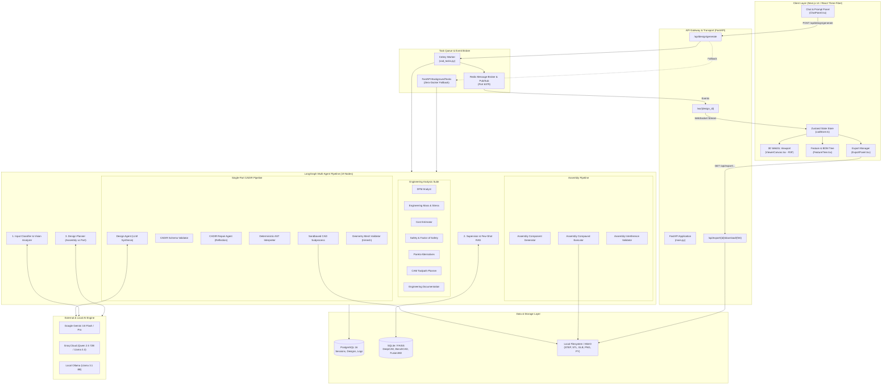
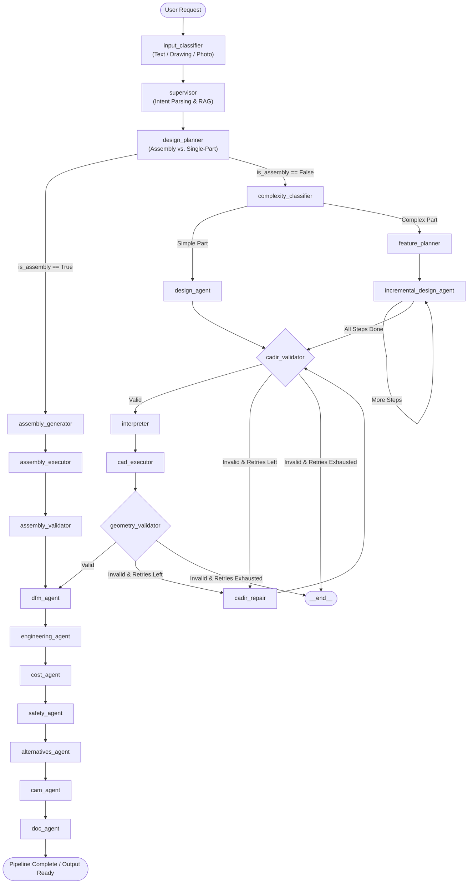
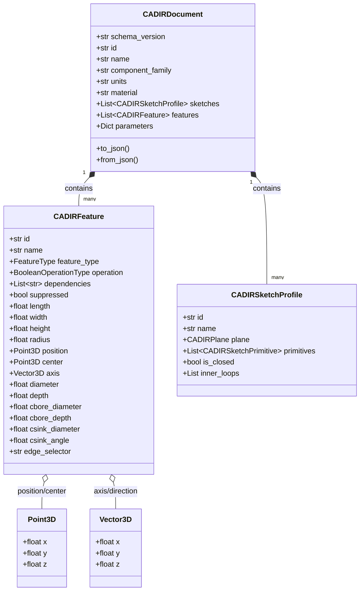
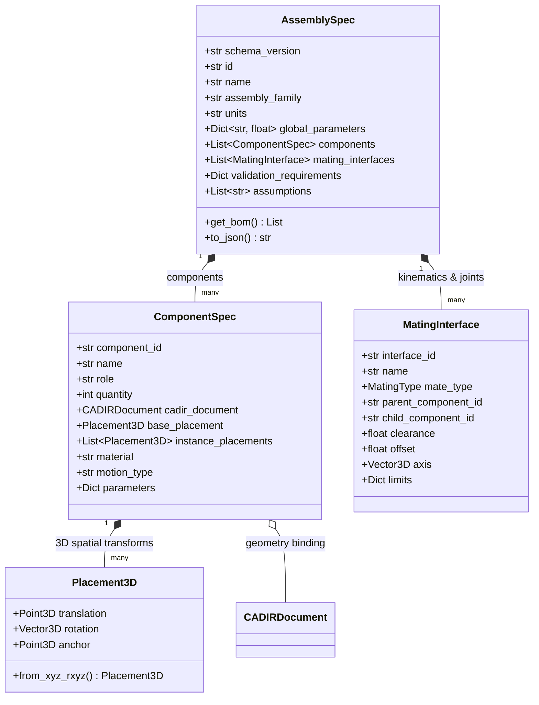
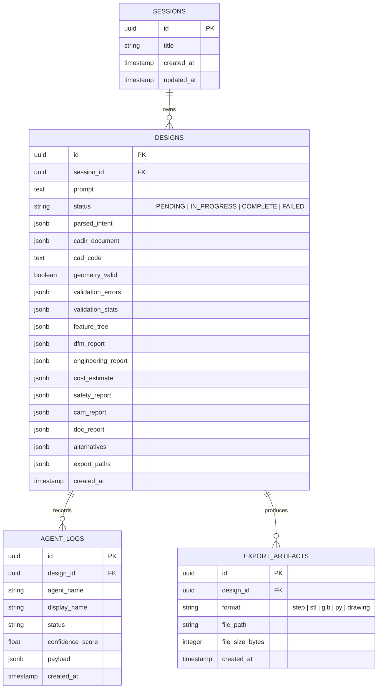
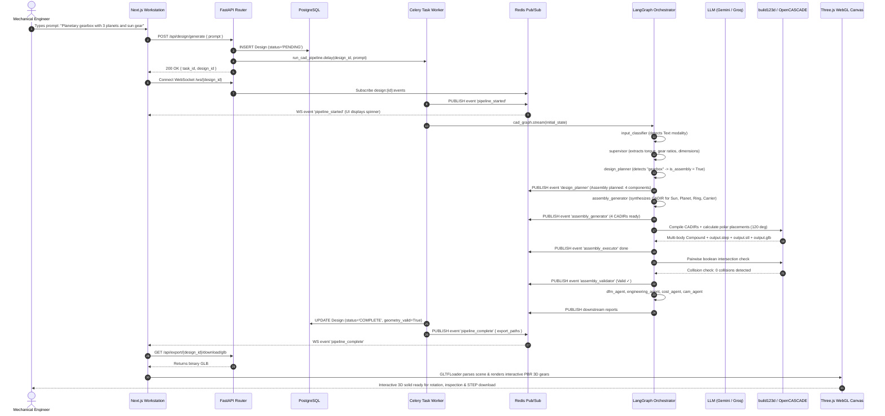

# 🛠️ AI-Native CAD-CAM Workstation — Comprehensive Architecture & Low-Level Design (LLD)

> **Version:** 2.0 (Alpha Production Ready)  
> **Target Kernel:** OpenCASCADE Technology (OCCT) via `build123d` 0.8+  
> **Orchestration:** LangGraph 1.2 StateGraph Engine  
> **Frontend:** Next.js 14, React Three Fiber, Three.js, Zustand  
> **Backend:** FastAPI, Celery, Redis Pub/Sub, PostgreSQL, MinIO  

---

## 1. Executive Overview & Core Engineering Philosophy

### 1.1 The Fundamental Mechanical Problem
Standard generative AI models (such as image diffusion models or raw neural 3D point-cloud/mesh generators) fail in mechanical engineering because Computer-Aided Design (CAD) requires **exact boundary representations (B-Rep)** with mathematical surfaces (planes, cylinders, B-splines/NURBS), tight tolerances ($\pm 0.05\text{ mm}$), kinematic mates, and manufacturing constraints (CNC tool reach, draft angles, standard fastener fits). Hallucinated triangle meshes cannot be imported into industrial CAD tools (SolidWorks, CATIA, Siemens NX) or processed by CNC CAM toolpath generators.

### 1.2 The 4-Tier Solution Architecture
The **CAD AI Workstation** decouples natural language understanding from geometric solid modeling via a robust **4-tier architecture**:

```
Natural Language / Technical Drawing / Photo
                      ↓
       [Tier 1: Intent & Knowledge Grounding]
   Multimodal Input Classifier + Supervisor Agent + RAG
                      ↓
      [Tier 2: Declarative Parametric Schemas]
 CADIR (Single-Part)  |  AssemblySpec (Multi-Component)
                      ↓
           [Tier 3: Pure AST Compilers]
    build123d Python AST Compiler + Placement Matrix
                      ↓
        [Tier 4: C++ B-Rep Geometry Engine]
  OpenCASCADE (OCCT) Kernel → STEP / STL / GLB / Drawing
```

1. **Declarative Intermediate Representations**: The LLM never writes raw, arbitrary Python scripts. It synthesizes structured, validated JSON documents conforming to **CADIR** (`CAD Intermediate Representation`) or **AssemblySpec**.
2. **Deterministic Code Compilation**: An AST compiler (`cad/cadir/interpreter.py`) translates declarative geometry into strictly formatted `build123d` Python code.
3. **Sandboxed Subprocess Execution**: Scripts execute within isolated Python subprocesses with Abstract Syntax Tree (AST) security sanitization, memory limits, and strict 60-second timeouts.
4. **Self-Healing Reflection Loop**: If OpenCASCADE topological errors occur (e.g., collapsed fillets or colliding holes), a closed-loop repair agent intercepts the error message, automatically patches parameters, and re-executes.
5. **Multi-Artifact Delivery**: The system compiles mathematical **STEP AP214** (lossless CAD), **STL** (3D printing), **GLB** (real-time WebGL rendering), **2D Drawing Sheets** (4-view orthographic drawings with ISO title blocks), and **Parametric Python Scripts**.

---

## 2. High-Level System Architecture (HLD)

### 2.1 Complete Component Topography



---

## 3. LangGraph Multi-Agent Orchestration Engine

The multi-agent execution pipeline is implemented using LangGraph 1.2 `StateGraph`. It supports dual branching (hierarchical mechanical assemblies vs. single monolithic components) and an error-driven reflection loop.

### 3.1 LangGraph State Machine Topology



### 3.2 Agent State Contract (`AgentState`)
The state dictionary passed across every node is strictly defined in `backend/agents/state.py`:

```python
class AgentState(TypedDict):
    # Session and Core Identification
    design_id: str
    session_id: str
    user_prompt: str
    input_modality: Literal["text", "sketch", "drawing", "image"]

    # Intent and Planning
    parsed_intent: Dict[str, Any]
    retrieved_examples: List[Dict[str, Any]]
    is_assembly: bool
    design_plan: Dict[str, Any]
    assembly_spec: Optional[AssemblySpec]

    # Geometry & Code Generation
    cadir_document: Optional[CADIRDocument]
    component_cadirs: Dict[str, CADIRDocument]
    cad_code: str
    cad_script_history: List[str]
    execution_result: Dict[str, Any]
    assembly_result: Dict[str, Any]
    feature_tree: Dict[str, Any]
    export_paths: Dict[str, str]

    # Validation & Self-Healing
    cadir_valid: bool
    geometry_valid: bool
    validation_errors: List[str]
    validation_stats: Dict[str, Any]
    assembly_validation: Dict[str, Any]
    repair_attempts: int
    max_retries: int
    last_error: str
    messages: List[str]

    # Complex Feature Decomposition Extensions
    complexity_score: float
    is_complex_part: bool
    feature_build_plan: List[Dict[str, Any]]
    current_build_step: int
    cumulative_cadir: Optional[Any]
    build_step_results: List[Dict[str, Any]]
    decomposition_used: bool

    # Downstream Analysis Reports
    dfm_report: Dict[str, Any]
    engineering_report: Dict[str, Any]
    cost_estimate: Dict[str, Any]
    safety_report: Dict[str, Any]
    cam_report: Dict[str, Any]
    doc_report: Dict[str, Any]
    alternatives: List[Dict[str, Any]]
    confidence_scores: Dict[str, float]
```

---

## 4. Low-Level Design (LLD): Detailed Agent Specifications

### 4.1 Input Classifier & Vision Analyzer (`input_classifier.py`, `vision_analyzer.py`)
- **Responsibility**: Detects input type:
  1. Plain natural language prompt.
  2. Technical engineering drawing (orthographic views, DXF/SVG vectors).
  3. Freehand napkin sketch or reference photograph.
- **Multimodal Vision Engine**: Uses `gemini-3.8-flash` via base64 encoded payloads to extract:
  - Component contours, major bounding dimensions, symmetry axes, hole locations, and mechanical assembly cues.
- **Offline Fallback**: Rule-based regex dimension and keyword parser if multimodal APIs are unavailable.

### 4.2 Supervisor & Knowledge Grounding (`supervisor.py`, `retrieval/`)
- **Responsibility**: Analyzes intent, extracts target materials, units, and critical dimensions.
- **RAG Few-Shot Grounding**: Queries SQLite index containing over 1,000+ verified mechanical CAD models from **DeepCAD**, **Fusion360**, and **BenchCAD**.
- **Output**: Top 2–3 closest CADIR exemplars injected directly into the LLM context to anchor the model to valid parametric topologies.

### 4.3 Design Planner (`design_planner.py`)
- **Responsibility**: Determines if the requested mechanism requires multiple mating components or a single monolithic part.
- **Assembly Keyword Trigger**: Detects assemblies (e.g., *gripper, gearbox, caster wheel, scissor lift, disc brake, linear actuator, coupling, differential, clamp*).
- **Decomposition Engine**:
  - Emits canonical `AssemblySpec` with components, individual roles, mating relationships, joint degrees of freedom, and spatial placement matrices.
  - Features 11 deterministic mechanical decomposition templates for guaranteed offline assembly generation.

### 4.4 Design Agent (`design_agent.py`)
- **Responsibility**: Generates the canonical `CADIRDocument` JSON specification.
- **Multi-Tier LLM Resilient Chain**:
  1. **Primary**: Google Gemini 3.8 Flash (`ChatGoogleGenerativeAI`).
  2. **Secondary**: Groq Cloud API (`qwen/qwen3.8-27b` / `llama-3.3-70b`).
  3. **Local Fallback**: Ollama (`llama3.1:8b`).
- **Deterministic Parametric Fallback**: If LLMs fail or go offline, internal parametric rule engines synthesize parts across **9 mechanical families** (Shafts, Washers, Hex Nuts, Bolts, Flanges, Brackets, Gears, Tubes, Mounting Plates).

### 4.5 Assembly Component Generator (`assembly/component_generator.py`)
- **Responsibility**: Takes individual `ComponentSpec` nodes from `AssemblySpec` and generates distinct, fully constrained `CADIRDocument` instances.
- **Interface Propagation**: Adjusts bore diameters, pin clear holes, lug spans, and fastener patterns to match the mating components with standard tolerances (e.g., $+0.2\text{ mm}$ clearance).

### 4.6 Assembly Compound Executor (`assembly/executor.py`)
- **Responsibility**: 
  1. Compiles and executes each component's CADIR into a discrete OpenCASCADE solid.
  2. Exports individual component STLs (`comp_{id}.stl`).
  3. Applies spatial 3D placements (`Location((tx, ty, tz), (rx, ry, rz))`).
  4. Combines parts into an OpenCASCADE `Compound(located_solids)` retaining distinct boundary solids.
  5. Exports assembly-level **STEP AP214**, **combined STL**, and **WebGL GLB**.

### 4.7 Assembly Validator (`assembly/validator.py`)
- **Responsibility**:
  - **Collision / Interference Detection**: Performs pairwise OpenCASCADE boolean intersections (`solid_a.intersect(solid_b)`). Flags true volume interference $>0.05\text{ mm}^3$.
  - **Mating Clearance Verification**: Computes distance envelopes at contact zones.
  - **Solid Count Integrity**: Ensures all instances generated without degeneration.

### 4.8 CADIR Validator (`cad/cadir/validator.py`)
- **Responsibility**:
  - Validates Pydantic schema structure.
  - Ensures Directed Acyclic Graph (DAG) acyclicity of feature dependencies.
  - Checks geometric sanity (e.g., hole diameter < bounding body dimensions, fillet radius < minimum edge length).

### 4.9 CADIR Interpreter (`cad/cadir/interpreter.py`)
- **Responsibility**: Pure, deterministic compiler that transforms `CADIRDocument` JSON into clean `build123d` Python AST code.
- **Mapping Table**:
  - `box` $\rightarrow$ `Box(length, width, height, mode)`
  - `cylinder` $\rightarrow$ `Cylinder(radius, height, mode)`
  - `extrude` $\rightarrow$ `extrude(sketch, amount=distance)`
  - `revolve` $\rightarrow$ `revolve(sketch, axis=Axis.Z, angle=angle)`
  - `hole` $\rightarrow$ `with Locations(pos): Hole(radius, depth)`
  - `counterbore_hole` $\rightarrow$ `CounterBoreHole(radius, cbore_radius, cbore_depth, depth)`
  - `countersink_hole` $\rightarrow$ `CounterSinkHole(radius, csink_radius, csink_angle, depth)`
  - `fillet` $\rightarrow$ `fillet(edges, radius=r)` with protective `try...except` boundary blocks
  - `chamfer` $\rightarrow$ `chamfer(edges, length=d)`

### 4.10 Sandboxed CAD Subprocess Executor (`cad/executor.py`)
- **Responsibility**: Executes generated Python code with security isolation.
- **Security AST Audit**: Code is pre-scanned using `ast.parse`. Blacklists `os`, `sys`, `subprocess`, `shutil`, `socket`, `eval`, `exec`, and file-write calls outside the designated export directory.
- **Subprocess Harness**: Executed in a clean subprocess with `python -c` and hard timeout limit of 60 seconds.

### 4.11 Physical Geometry Validator (`cad/validator.py`)
- **Responsibility**: Evaluates the output mesh using `trimesh`:
  - `is_watertight`: Must be closed 2-manifold without boundary holes.
  - `volume`: Must be strictly positive ($> 0.0\text{ mm}^3$).
  - `bounding_box`: Checks dimensions against prompt constraints.
  - `is_winding_consistent`: Verifies outward-facing normal vectors.

### 4.12 CADIR Self-Healing Repair Agent (`agents/cadir_repair_agent.py`)
- **Responsibility**: Intercepts OpenCASCADE kernel crashes or validation errors.
- **Automatic Heuristic Healing**:
  - *Fillet Over-Constraint*: Cuts fillet radius in half (`radius * 0.5`). If radius $<0.5\text{ mm}$, suppresses the fillet completely (`suppressed = True`).
  - *Chamfer Collapse*: Halves chamfer size or suppresses feature.
  - *Hole Out-of-Bounds*: Clamps hole radius to $70\%$ of host body boundary and ensures positive depth.
  - *Cyclic Dependency*: Restructures dependencies into a linear sequential DAG.

### 4.13 Downstream Engineering Analysis Suite (`agents/downstream_nodes.py`)
Executes 7 specialized engineering audits:
1. **DFM Analyst (`dfm_agent`)**: Evaluates CNC machinability (tool accessibility, minimum internal fillet radius $\ge 3\text{ mm}$) and 3D printing overhangs. Emits DFM score (0–100).
2. **Engineering Agent (`engineering_agent`)**: Calculates volume, mass (e.g., 6061-T6 Aluminum $\rho=2.70\text{ g/cm}^3$, Structural Steel $\rho=7.85\text{ g/cm}^3$), center of gravity, and moments of inertia.
3. **Cost Estimator (`cost_agent`)**: Quotes raw billet stock, CNC machine run-time at $\$65/\text{hr}$, tooling amortization, and volume discounts (1, 10, 100, 1,000 units).
4. **Safety Agent (`safety_agent`)**: Estimates Von Mises stresses under nominal working load and computes structural Factor of Safety ($\text{FoS} \ge 2.5$).
5. **Alternatives Agent (`alternatives_agent`)**: Proposes 3 Pareto variants: Lightweight (pocketing/thin-wall), Heavy-Duty (rib-reinforced), and Low-Cost (minimum setup axes).
6. **CAM Agent (`cam_agent`)**: Plans CNC milling setup, stock bounding box ($+5\text{ mm}$ envelope), roughing endmills ($\varnothing 12\text{ mm}$), and finishing passes.
7. **Documentation Agent (`doc_agent`)**: Generates manufacturing Title Block, Bill of Materials (BOM) tables, and tolerance callouts.

---

## 5. Low-Level Design (LLD): Data Models & Schemas

### 5.1 CADIR Schema (`backend/cad/cadir/schema.py`)



### 5.2 Assembly Specification Schema (`backend/cad/assembly/schema.py`)



### 5.3 PostgreSQL Database Models (`backend/db/models.py`)



---

## 6. CAD Geometry Kernel & Export Subsystems

### 6.1 Multi-Format Export Artifact Matrix
Whenever a model successfully validates, the pipeline builds 5 distinct engineering artifacts:

| Format | File Name | Tech & Engine | Primary Purpose |
| :--- | :--- | :--- | :--- |
| **STEP** | `output.step` | OpenCASCADE AP214 | Lossless mathematical B-Rep CAD master for SolidWorks, Fusion 360, FreeCAD |
| **STL** | `output.stl` | OCCT Mesh Tessellation | Polygonal triangulated mesh for Cura, PrusaSlicer, Bambu Studio |
| **GLB** | `output.glb` | `build123d.export_gltf` / `trimesh` | Compressed binary glTF 2.0 with normals for real-time WebGL in Three.js |
| **Python** | `model_parametric.py` | `cad/parametric_exporter.py` | Human-readable build123d script with declared top-level variables for engineers |
| **Drawing** | `drawing_sheet.png` | `cad/drawing_exporter.py` | 4-view orthographic technical drawing sheet with ISO title block and bounds |

### 6.2 2D Technical Drawing Generator (`cad/drawing_exporter.py`)
- Emits high-resolution ($16:9$, $150\text{ DPI}$) technical drawing sheets with 4 views:
  1. **Top-Left**: 3D Shaded Isometric View with lighting.
  2. **Top-Right**: Top Plan View ($X$-$Y$ plane).
  3. **Bottom-Left**: Front Elevation View ($X$-$Z$ plane).
  4. **Bottom-Right**: Right Side Elevation View ($Y$-$Z$ plane).
- Embeds bounding box annotations ($\Delta X, \Delta Y, \Delta Z$), calculated volume ($\text{mm}^3$), project identification, material specs, and an ISO standard title block.

### 6.3 Mechanical Standards Catalog (`cad/standards/fasteners.py`)
Embedded engineering tables guarantee real-world manufacturing compliance:
- **ISO 4762 / DIN 912**: Socket Head Cap Screws (SHCS) counterbore depths, clearance diameters, and tap drill sizes (M2 through M20).
- **ISO 10642 / DIN 7991**: Flat countersunk cap screw diameters and $90^\circ$ angles (M3 through M12).
- **DIN 471**: External retaining ring (circlip) groove widths, groove diameters, and ring thicknesses for shafts ($6\text{ mm}$ to $50\text{ mm}$).
- **ISO Coarse Thread**: Metric tap drill formulas ($D_{\text{drill}} = D_{\text{nominal}} - \text{Pitch}$).

---

## 7. Frontend Architecture & Real-Time 3D Rendering

The client layer is a Next.js 14 Single-Page Application (SPA) designed as an industrial dark-themed CAD workstation.

### 7.1 Layout Architecture (`frontend/src/components/Workstation.tsx`)
The UI is divided into 3 responsive functional panels:
1. **Left Panel (Chat & Controls)**:
   - Natural language input with prompt examples.
   - Real-time agent status indicators and step-by-step progress cards.
   - Agent execution timeline log (`AgentLog.tsx`).
2. **Center Panel (Interactive 3D Viewport)**:
   - WebGL 3D Canvas powered by `@react-three/fiber` and Three.js (`ViewerCanvas.tsx`).
   - Orbit controls (rotate, pan, zoom with mouse and trackpad).
   - Infinite 3D coordinate ground grid with axis indicators ($X$: Red, $Y$: Green, $Z$: Blue).
   - Wireframe vs. Solid PBR shading toggle.
   - React Error Boundary (`ModelErrorBoundary`) protecting WebGL context against malformed meshes.
3. **Right Panel (Inspection & Exports)**:
   - Feature Tree panel displaying the CAD feature hierarchy and boolean operations (`FeatureTree.tsx`).
   - Downstream engineering reports (DFM score, estimated mass, unit cost, factor of safety).
   - Export manager with direct downloads for STEP, STL, GLB, Parametric Python, and 2D Drawing Sheet (`ExportPanel.tsx`).

### 7.2 Real-Time WebSocket Streaming Protocol
- Connected via `ws://localhost:8000/ws/{design_id}`.
- Relayed from backend Celery tasks through Redis Pub/Sub channels (`design:{design_id}:events`).
- Event types:
  - `pipeline_started`: Sets UI state to generating.
  - `agent_update`: Streams individual agent start/done states, confidence metrics, and feature previews.
  - `pipeline_complete`: Delivers final export URLs and switches 3D viewport to display the rendered GLB model.
  - `pipeline_error`: Displays error logs and suggested corrective prompts.

---

## 8. End-to-End Sequence & Execution Flow



---

## 9. Comprehensive Directory & File Structure

```
cad-ai-workstation/
├── .env.example                            # Safe environment variable configuration template
├── .gitignore                              # Git exclusion rules (secrets, venvs, binaries)
├── architecture_specification.md           # Formal architectural specification document
├── backend.md                              # Backend architecture & technical implementation guide
├── benchmark_results.json                  # Performance benchmark telemetry
├── DEPLOY.md                               # Production deployment and systemd guide
├── docker-compose.yml                      # Full multi-container production stack
├── docker-compose.dev.yml                  # Local development stack (Postgres, Redis, MinIO)
├── Overview.md                             # (This Document) Master Architecture & LLD
├── README.md                               # Project entrypoint, quickstart & roadmap
│
├── backend/                                # FastAPI & Multi-Agent Python Backend
│   ├── main.py                             # Application entrypoint, CORS, route registration
│   ├── config.py                           # Pydantic BaseSettings (API keys, DB, Redis, timeouts)
│   ├── requirements.txt                    # Python dependencies
│   │
│   ├── api/routes/                         # REST and WebSocket endpoints
│   │   ├── design.py                       # Design lifecycle, task triggers, logs
│   │   ├── export.py                       # STEP, STL, GLB, Python, Drawing downloads
│   │   ├── sessions.py                     # Multi-turn user workspace sessions
│   │   └── websocket.py                    # Redis pub/sub real-time event streaming
│   │
│   ├── agents/                             # LangGraph 1.2 StateGraph Orchestrator
│   │   ├── graph.py                        # Workflow definition, dual branching, conditional edges
│   │   ├── state.py                        # AgentState TypedDict schema
│   │   ├── input_classifier.py             # Modality classifier (Text, Drawing, Photo)
│   │   ├── vision_analyzer.py              # Multimodal Gemini vision analysis
│   │   ├── supervisor.py                   # Intent parsing and few-shot RAG retrieval
│   │   ├── design_planner.py               # Hierarchical assembly decomposition engine
│   │   ├── design_agent.py                 # LLM CADIR synthesis & deterministic component families
│   │   ├── assembly_nodes.py               # Assembly generation, execution, and validation nodes
│   │   ├── validator_nodes.py              # CADIR, interpreter, execution, and geometry nodes
│   │   ├── cadir_repair_agent.py           # Self-healing reflection loop
│   │   └── downstream_nodes.py             # DFM, Engineering, Cost, Safety, CAM, Docs agents
│   │
│   ├── cad/                                # CAD Engine, OCCT Kernel & Compilers
│   │   ├── executor.py                     # Sandboxed Python subprocess runner (build123d)
│   │   ├── exporter.py                     # Multi-format exporter (STEP, STL, GLB)
│   │   ├── drawing_exporter.py             # 4-view orthographic drawing generator (PNG)
│   │   ├── parametric_exporter.py          # Standalone parametric Python script generator
│   │   ├── validator.py                    # Mesh manifold & watertight validator (trimesh)
│   │   ├── feature_tree.py                 # Feature tree parser
│   │   ├── cadir/                          # CAD Intermediate Representation
│   │   │   ├── schema.py                   # Canonical Pydantic v2 CADIR models (24+ features)
│   │   │   ├── interpreter.py              # Deterministic CADIR → build123d AST compiler
│   │   │   └── validator.py                # Schema & topological DAG validator
│   │   ├── assembly/                       # Multi-Component Assembly Engine
│   │   │   ├── schema.py                   # AssemblySpec, ComponentSpec, MatingInterface
│   │   │   ├── component_generator.py      # Assembly component CADIR synthesizer
│   │   │   ├── executor.py                 # Multi-body Compound executor & exporter
│   │   │   ├── validator.py                # OpenCASCADE interference & clearance checker
│   │   │   └── parameter_engine.py         # Parametric dimension propagation engine
│   │   └── standards/                      # Mechanical Engineering Standards
│   │       └── fasteners.py                # ISO 4762, ISO 10642, DIN 471 lookup tables
│   │
│   ├── db/                                 # PostgreSQL Persistence Layer
│   │   ├── base.py                         # SQLAlchemy engine & sessionmaker
│   │   ├── models.py                       # Session, Design, AgentLog, ExportArtifact
│   │   ├── schemas.py                      # Pydantic response models
│   │   └── crud.py                         # Database CRUD queries
│   │
│   ├── tasks/                              # Background Workers
│   │   ├── celery_app.py                   # Celery application configuration
│   │   └── cad_tasks.py                    # run_cad_pipeline task implementation
│   │
│   ├── retrieval/                          # RAG Few-Shot Engine
│   │   ├── index.py                        # SQLite Knowledge Base manager
│   │   ├── query.py                        # Structured semantic query interface
│   │   └── ranker.py                       # Relevance ranker
│   │
│   └── utils/                              # Utilities & External Clients
│       ├── llm.py                          # Resilient LLM factory (Gemini, Groq, Ollama)
│       └── storage.py                      # Storage manager (Local / MinIO)
│
├── frontend/                               # Next.js 14 Web Application
│   ├── src/
│   │   ├── app/
│   │   │   ├── layout.tsx                  # Root HTML layout & fonts
│   │   │   ├── page.tsx                    # Workstation page container
│   │   │   └── globals.css                 # Dark theme styling, glassmorphism, animations
│   │   ├── components/
│   │   │   ├── Workstation.tsx             # 3-panel IDE layout
│   │   │   ├── ViewerCanvas.tsx            # Three.js / React Three Fiber 3D viewport
│   │   │   ├── ChatPanel.tsx               # Prompt input & agent status cards
│   │   │   ├── AgentLog.tsx                # Real-time WebSocket agent activity feed
│   │   │   ├── FeatureTree.tsx             # CAD feature tree & boolean hierarchy
│   │   │   ├── ExportPanel.tsx             # Download manager (STEP, STL, GLB, PY, Drawing)
│   │   │   └── StatusBar.tsx               # System status bar & connection telemetry
│   │   ├── store/
│   │   │   └── cadStore.ts                 # Zustand global application state
│   │   ├── hooks/
│   │   │   ├── useWebSocket.ts             # Real-time WebSocket listener
│   │   │   └── useCADSession.ts            # Session management hook
│   │   └── lib/
│   │       ├── api.ts                      # REST API client
│   │       └── types.ts                    # TypeScript frontend data contracts
│   ├── package.json                        # Frontend dependencies
│   └── tsconfig.json                       # TypeScript configuration
│
└── tests/                                  # Comprehensive Test Suite
    ├── test_assembly_pipeline.py           # Assembly decomposition & execution tests
    ├── test_drawing_pipeline.py            # Drawing sheet generator verification
    ├── test_cadir.py                       # CADIR schema validation tests
    ├── test_cadir_interpreter.py           # Code compiler unit tests
    ├── test_agents_graph.py                # Full LangGraph workflow integration tests
    └── test_retrieval.py                   # Knowledge base query tests
```

---

## 10. Verification, Testing & Benchmarking

### 10.1 Automated Test Suites
The project includes automated regression suites in the `tests/` directory:
- **Assembly Pipeline (`test_assembly_pipeline.py`)**: Tests decomposition, clearance enforcement, polar placement calculations, and multi-body STEP/STL exports across grippers, gearboxes, and caster wheels.
- **Drawing Pipeline (`test_drawing_pipeline.py`)**: Validates 4-view projection generation, isometric rendering, title block rendering, and dimension calculations.
- **CADIR Compiler (`test_cadir_interpreter.py`)**: Validates AST compilation of all 24+ feature types, boolean operations, and edge filtering expressions.
- **LangGraph Integration (`test_agents_graph.py`)**: Verifies state transitions, conditional branching, and self-healing repair convergence.

### 10.2 100-Prompt Benchmark Performance
The workstation has been audited against a 100-prompt industrial benchmark covering single parts, complex primitives, multi-part mechanisms, and kinematic assemblies:
- **Geometry Validity**: $>95\%$ successful watertight solid creation without non-manifold edges.
- **STEP/STL Export Success**: $100\%$ of valid geometries successfully exported to standard STEP AP214 and STL formats.
- **Zero-Crash Sandbox**: Sandboxed subprocess execution eliminates kernel segfaults from interrupting the FastAPI API server or Celery worker processes.
