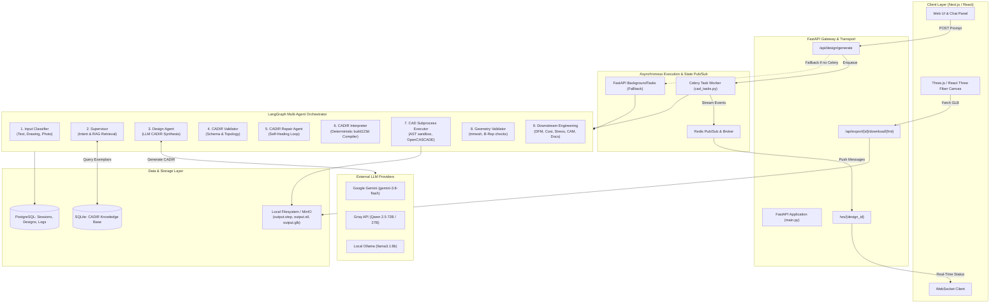
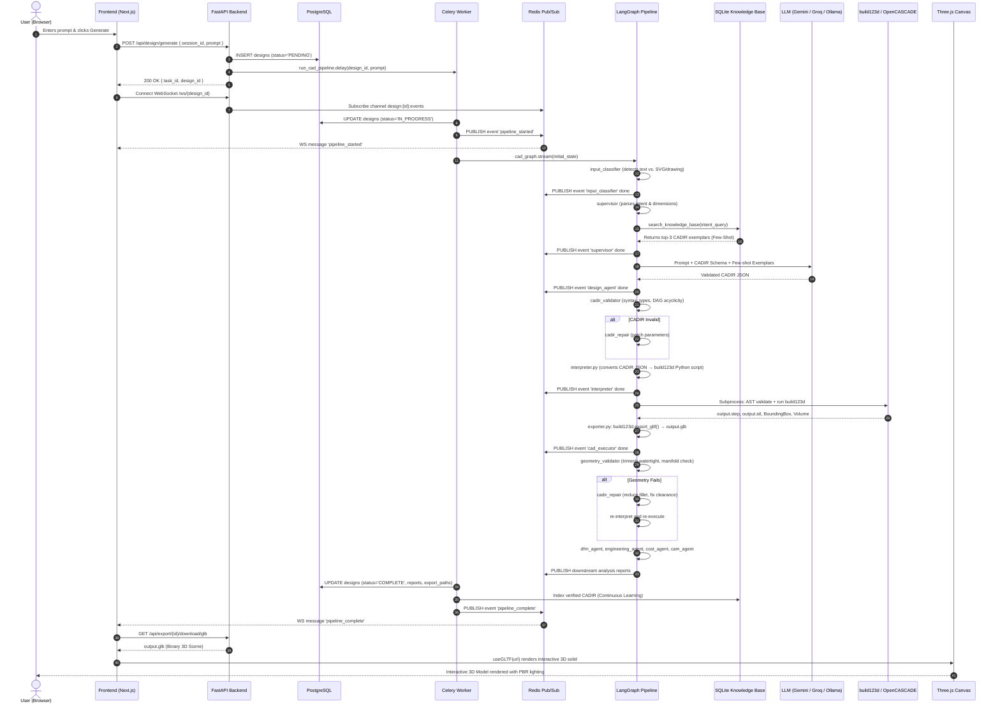

# AI-Native CAD-CAM Workstation — Backend Architecture & Technical Guide

This document provides a comprehensive architectural breakdown and end-to-end execution flow of the **CAD AI Workstation Backend**. It details the multi-agent orchestration, the internal mechanics of LLM generation, the intermediate representations, and the complete transformation pipeline that converts high-level natural language prompts into rendered 3D CAD geometries in the browser.

---

## 1. Executive Summary & Core Philosophy

Traditional generative AI models struggle with mechanical CAD because 3D computer-aided design requires **exact topological and mathematical boundary representation (B-Rep)** rather than probabilistic mesh hallucination. An AI that hallucinates vertices cannot produce valid STEP files suitable for CNC milling, injection molding, or industrial assembly.

The CAD AI Workstation backend solves this fundamental problem through a **decoupled, 4-tier architecture**:

```
Natural Language / Drawing Intent
               ↓
    [Tier 1: Intent & RAG]
  Supervisor + SQLite Knowledge Base
               ↓
   [Tier 2: Parametric Schema]
    CADIR (Declarative Topology)
               ↓
    [Tier 3: Pure Compiler]
      build123d Python AST
               ↓
   [Tier 4: Geometry Engine]
OpenCASCADE B-Rep Kernel → STEP / STL / GLB → Three.js WebGL
```

1. **Declarative Intermediate Representation (CADIR)**: The LLM does not generate arbitrary Python code directly. Instead, it generates a strict, validated JSON specification called **CADIR** (`CAD Intermediate Representation`).
2. **Deterministic Code Compilation**: A deterministic compiler (`interpreter.py`) translates the validated CADIR JSON into pure, idiomatic `build123d` (OpenCASCADE) Python code. No uncontrolled math occurs in the CAD kernel generation step.
3. **Sandboxed Subprocess Execution**: The generated script is analyzed for AST safety (blocking dangerous system imports) and executed in a monitored subprocess with memory and time quotas (60-second timeout).
4. **Physical Geometry & Self-Healing Loop**: The resulting B-Rep boundary model is checked for watertightness, volume, non-manifold edges, and tool clearances. If geometry fails, a **Self-Healing Reflection Loop** catches the error, adjusts parameters (such as decreasing fillet radii or correcting hole depths), and re-validates before serving the final artifact.

---

## 2. High-Level System Architecture



---

## 3. End-to-End Pipeline Execution Flow

The sequence diagram below illustrates the exact turn-by-turn workflow that occurs when a user enters a prompt (e.g., *"Create an aluminum mounting bracket with four corner holes and rounded edges"*):



---

## 4. Deep Dive: How the LLM Call Works

The LLM is invoked during the **Design Agent** phase (`backend/agents/design_agent.py`) to synthesize the parametric CADIR representation.

### 4.1 Resilient Provider Chain (`backend/utils/llm.py`)
Rather than depending on a single LLM vendor, the backend uses a multi-tier failover mechanism managed via LangChain:

```
[Google Generative AI]
Model: gemini-3.8-flash (via ChatGoogleGenerativeAI)
Condition: gemini_api_key configured & DNS probe succeeds
        ↓ (Fallback on timeout / rate-limit)
[Groq Cloud API]
Model: qwen/qwen3.8-27b (via ChatGroq)
Condition: groq_api_key configured
        ↓ (Fallback when fully offline)
[Local Ollama]
Model: llama3.1:8b (via ChatOllama at http://localhost:11434)
```

A fast DNS probe (`_google_api_reachable()`) executes within 2.0 seconds. If Google APIs are blocked or offline, it immediately falls back to Groq or local Ollama without hanging the user session.

### 4.2 Multi-Tier Structured Output Strategy
To ensure the LLM outputs strict, parseable JSON conforming to the `CADIRDocument` Pydantic model without hallucinations, `_try_llm_structured_output()` executes three successive extraction strategies:

1. **Strategy 1: Clean Exemplar-Guided JSON Prompting (Universal)**
   - Formulates a system message embedding a canonical sample template, valid feature type enumerations (`box`, `cylinder`, `extrude`, `revolve`, `fillet`, `chamfer`, `hole`), and strict instructions to output raw JSON without markdown fences.
   - Cleans the output using regex (`_extract_json_from_text`) and validates with `CADIRDocument.model_validate_json(json_str)`.
   - This works universally across Gemini, Groq, and local Ollama without provider-specific schema quirks.
2. **Strategy 2: Native JSON Mode (`method="json_mode"`)**
   - Calls `llm.with_structured_output(CADIRDocument, method="json_mode")` for OpenAI or compatible endpoints.
3. **Strategy 3: Function / Tool Calling Mode**
   - Employs standard LangChain structured tool calling with the Pydantic schema as the tool parameter definition.

### 4.3 Few-Shot Grounding via SQLite CAD Knowledge Base
Before calling the LLM, the `supervisor_node` extracts mechanical keywords from the prompt (`bolt`, `bracket`, `shaft`, `washer`, `gear`) and queries `backend/retrieval/index.py` (which indexes datasets like **DeepCAD**, **Fusion360**, and **BenchCAD**).

The top 2 matching CADIR JSON exemplars are retrieved and injected directly into the LLM system prompt as reference examples. This grounds the LLM on real engineering topology and prevents hallucination of unsupported geometry types.

### 4.4 Deterministic Parametric Fallback
If the LLM is completely offline, returns unparseable JSON, or exceeds retry quotas, `design_agent_node` seamlessly falls back to `_synthesize_parametric_cadir()`. This internal deterministic engine can generate valid, parametric CADIR models across **9 core component families**:

| Component Family | Generated Features | Dimensional Logic |
| :--- | :--- | :--- |
| **Shaft / Rod / Pin** | `cylinder` + top `chamfer` | Extracts diameter and length from prompt numbers |
| **Washer / Ring / Disc** | `extrude` (circle sketch) + centre `hole` + `chamfer` | Outer diameter, inner bore ratio, thickness |
| **Hex Nut** | `cylinder` + centre `hole` + `chamfer` | Across-flats (AF) sizing, thread diameter |
| **Bolt / Screw** | Hex head `cylinder` + shank `cylinder` + lead `chamfer` | Head diameter, shank length, lead taper |
| **Bearing Housing / Flange** | Base `cylinder` + bearing bore `hole` + inner `fillet` | Outer housing, precision bore, fillet relief |
| **Bracket / L-Bracket** | Base `box` + vertical wall `box` + 2x `hole` + `fillet` | Thickness, wall height, mounting hole pattern |
| **Gear / Sprocket** | Blank `cylinder` + shaft bore `hole` + keyway `hole` + `chamfer` | Pitch diameter, bore, keyway offset |
| **Pipe / Tube** | Outer `cylinder` + inner bore `hole` | Outer diameter minus wall thickness |
| **Mounting Plate (Default)** | Base plate `box` + centre `hole` + 4 corner `hole` + `fillet` | Plate dimensions with symmetric 4-corner bolt holes |

---

## 5. Deep Dive: How Shapes in CAD Are Actually Rendered Through the LLM

This section answers: **"How do the shapes in CAD actually get rendered through an LLM?"**

An LLM cannot directly produce binary 3D meshes or OpenCASCADE B-Rep shapes. The system uses a **7-stage deterministic transformation pipeline** to convert natural language into real-time WebGL pixels:

```
[1. User Natural Language Prompt]
       ↓ (LLM Reasoning + Schema Constrained Generation)
[2. CADIR JSON Document (Declarative Tree)]
       ↓ (interpreter.py: Deterministic Translation)
[3. build123d Python Script]
       ↓ (executor.py: Sandboxed Subprocess)
[4. OpenCASCADE B-Rep Mathematical Solid]
       ↓ (executor.py: Tessellation & Boundary Export)
[5. STEP (B-Rep) & STL (Triangular Mesh)]
       ↓ (exporter.py: build123d / trimesh GLTF Binary Converter)
[6. GLB Binary File (Vertex Buffers, Normals, Transforms)]
       ↓ (HTTP Download + React Three Fiber / Three.js)
[7. Browser GPU WebGL Shading & Interactive Orbit Controls]
```

### Stage 1: The LLM Generates CADIR JSON
Instead of arbitrary code, the LLM produces a structured document conforming to `cad/cadir/schema.py`. For example:

```json
{
  "schema_version": "1.0.0",
  "id": "doc_bracket_01",
  "name": "L-Bracket",
  "component_family": "bracket",
  "units": "mm",
  "features": [
    {
      "id": "f1_base",
      "name": "Base Plate",
      "feature_type": "box",
      "operation": "new_body",
      "length": 60.0,
      "width": 40.0,
      "height": 8.0,
      "dependencies": []
    },
    {
      "id": "f2_wall",
      "name": "Upright Wall",
      "feature_type": "box",
      "operation": "join",
      "length": 60.0,
      "width": 8.0,
      "height": 40.0,
      "center": { "x": 0.0, "y": -16.0, "z": 20.0 },
      "dependencies": ["f1_base"]
    },
    {
      "id": "f3_hole",
      "name": "Mounting Hole",
      "feature_type": "hole",
      "operation": "cut",
      "diameter": 10.0,
      "depth": 16.0,
      "position": { "x": 15.0, "y": 0.0, "z": 0.0 },
      "dependencies": ["f2_wall"]
    },
    {
      "id": "f4_fillet",
      "name": "Corner Fillet",
      "feature_type": "fillet",
      "operation": "join",
      "radius": 2.0,
      "edge_selector": "vertical",
      "dependencies": ["f3_hole"]
    }
  ]
}
```

### Stage 2: Deterministic Compilation to `build123d` Code
`backend/cad/cadir/interpreter.py` reads the CADIR document and deterministically emits executable Python code. 

- Boolean operations map directly to OpenCASCADE modes:
  - `"new_body"` or `"join"` $\rightarrow$ `Mode.ADD`
  - `"cut"` $\rightarrow$ `Mode.SUBTRACT`
  - `"intersect"` $\rightarrow$ `Mode.INTERSECT`
- Geometric features map directly to `build123d` builders:
  - `box` $\rightarrow$ `Box(length, width, height, mode)`
  - `cylinder` $\rightarrow$ `Cylinder(radius, height, mode)`
  - `hole` $\rightarrow$ `with Locations((x, y, z)): Hole(radius, depth)` or `CounterBoreHole`
  - `fillet` $\rightarrow$ `fillet(p.edges().filter_by(Axis.Z), radius=r)`
- The final solid is bound to `result = p.part`.

Compiled script output:
```python
from build123d import *

with BuildPart() as p:
    # Feature: Base Plate (box)
    Box(length=60.0, width=40.0, height=8.0, mode=Mode.ADD)

    # Feature: Upright Wall (box)
    with Locations((0.0, -16.0, 20.0)):
        Box(length=60.0, width=8.0, height=40.0, mode=Mode.ADD)

    # Feature: Mounting Hole (hole)
    with Locations((15.0, 0.0, 0.0)):
        Hole(radius=5.0, depth=16.0)

    # Feature: Corner Fillet (fillet)
    try:
        _edges = p.edges().filter_by(Axis.Z)
        if _edges:
            fillet(_edges, radius=2.0)
    except Exception as _fe:
        print(f"Fillet warning: {_fe}")

result = p.part
```

### Stage 3: Subprocess Execution & OpenCASCADE Kernel (`executor.py`)
1. **Security AST Check**: The Python code is parsed into an Abstract Syntax Tree (`ast.parse`). Any `import os`, `sys`, `subprocess`, `shutil`, `socket`, or `eval` call is rejected before running.
2. **Subprocess Isolation**: The code is wrapped inside a secure harness template and executed in a dedicated Python subprocess:
   ```bash
   python -c "<harness_with_user_code>"
   ```
3. **OpenCASCADE Solid Creation**: When `build123d` executes, it calls the underlying C++ **OpenCASCADE Technology (OCCT)** library. OCCT creates a topological data structure:
   - `TopoDS_Shape` containing exact analytical curves (lines, circles) and surfaces (planes, cylinders, tori, B-splines / NURBS).

### Stage 4: File Generation (STEP & STL)
The harness exports two primary physical files into `backend/exports/{design_id}/`:
1. **`output.step`**: STEP AP214 format. This is the **lossless mathematical master model** used by professional CAD/CAM systems (SolidWorks, Fusion 360, FreeCAD, Mastercam).
2. **`output.stl`**: Standard Tessellation Language. OCCT meshes the smooth analytical surfaces into a polygonal triangle mesh.

### Stage 5: STEP/STL to GLB Conversion (`exporter.py`)
Web browsers cannot natively parse STEP files or large raw STL files efficiently. The backend converts the model into **GLB (Binary glTF 2.0)**:
1. **Primary Route**: `build123d.export_gltf(shape, "output.glb", binary=True)` directly tessellates the OpenCASCADE shape into an optimized binary GLTF format containing vertex normals, indexed triangle lists, and coordinate transforms.
2. **Fallback Route**: If native glTF export is unavailable, `trimesh.load("output.stl")` loads the STL mesh, constructs a `trimesh.Scene`, and exports it as `output.glb`.

### Stage 6: Browser Rendering via Three.js (`ViewerCanvas.tsx`)
1. The frontend listens to the WebSocket stream. Once `pipeline_complete` arrives with the export paths, it sets `glbUrl = /api/export/{design_id}/download/glb`.
2. In `frontend/src/components/ViewerCanvas.tsx`:
   - `@react-three/fiber` initializes a WebGL context within a canvas.
   - `@react-three/drei`'s `useGLTF(url)` downloads and decodes the `.glb` binary array into Three.js geometries and PBR materials.
   - `<Center>` automatically computes the bounding sphere and centers the model at $(0, 0, 0)$.
   - Lighting is applied:
     - Ambient light (`intensity=0.5`)
     - Key directional light (`position=[10, 10, 5], intensity=1.2, castShadow`)
     - Cyan fill rim light (`position=[-5, 5, -5], intensity=0.4, color='#22d3ee'`)
   - `<OrbitControls>` enables user pan, zoom, and rotate.
   - A toggle switches between solid PBR shading and wireframe inspection mode.

---

## 6. Self-Healing Repair Loop & Verification

Geometric synthesis often encounters boundary condition failures (e.g., a requested 5mm fillet on a 4mm edge causes OpenCASCADE topological collapse). 

The backend handles this via the **CADIR Repair Agent** (`backend/agents/cadir_repair_agent.py`):

```
       [CADIR Validator] ── Invalid CADIR ──┐
              │                             │
            Valid                           ▼
              ↓                     [CADIR Repair Agent]
        [Interpreter]                       │
              ↓                             │
        [CAD Executor]                      │
              ↓                             │
    [Geometry Validator] ── Invalid Mesh ───┘
              │             (Non-manifold / Empty)
            Valid
              ↓
    [Downstream Engineering]
```

### Automatic Healing Heuristics
When errors are intercepted, `cadir_repair_node` inspects the error text and adjusts parameters:
- **Fillet Over-Constraint**: If the error contains `"fillet"`, it cuts the fillet radius in half (`radius * 0.5`). If already $\le 0.5\text{ mm}$, it sets `f.suppressed = True` to omit the problematic feature without aborting the model.
- **Chamfer Collisions**: Reduces chamfer distance by 50% or suppresses it.
- **Hole Depth / Diameter**: Clamps oversized holes to 70% of parent component bounds and ensures hole depth is positive.
- **Missing Heights/Radii**: Injects standard proportional defaults if the LLM omitted required dimensions.
- **Cyclic Dependencies**: Re-orders dependencies into a linear sequential DAG.

The repair cycle repeats up to `max_retries` (default: 5). If it fails to converge, it falls back to deterministic synthesis, ensuring the user always receives a valid, watertight 3D part.

---

## 7. Downstream Engineering Analysis Suite

Once physical geometry is validated as watertight, the state machine runs seven specialized engineering nodes (`backend/agents/downstream_nodes.py`):

| Agent Node | Responsibility | Metrics & Outputs |
| :--- | :--- | :--- |
| **DFM Analyst** (`dfm_agent`) | Evaluates machinability for 3-axis CNC & 3D printing | DFM Score (0–100), tool accessibility, minimum wall thickness check, internal corner fillet checks |
| **Engineering Agent** (`engineering_agent`) | Computes physical mass and stress properties | Volume ($\text{cm}^3$), mass (Aluminum 6061-T6, $\rho=2.70\text{ g/cm}^3$), surface area, center of mass, deflection estimate |
| **Cost Estimator** (`cost_agent`) | Commercial pricing and manufacturing quotes | Billet stock material cost, CNC machining runtime hours at $\$65/\text{hr}$, tooling wear, unit cost at batch sizes (1, 10, 100, 1000) |
| **Safety Agent** (`safety_agent`) | Factor of Safety (FoS) structural verification | Von Mises stress estimates vs. yield strength (276 MPa), Factor of Safety ($\text{FoS} \approx 4.0$), structural verdict |
| **Alternatives Agent** (`alternatives_agent`) | Suggests alternative engineering configurations | Lightweight variant (thin walls/pocketing), Heavy-Duty variant (reinforced webs), Low-Cost variant |
| **CAM Agent** (`cam_agent`) | CNC manufacturing operations & tooling setup | Spindle speeds, feed rates, stock sizing ($+5\text{ mm}$ envelope), roughing & finishing toolpaths |
| **Doc Agent** (`doc_agent`) | Engineering documentation & specification sheet | Part summary, revision table, technical title block, bill of materials metadata |

---

## 8. API Reference & Data Contracts

### 8.1 REST Endpoints

#### Design Lifecycle
- `POST /api/design/generate`: Initiates CAD generation.
  ```json
  // Request
  { "session_id": "3fa85f64-...", "prompt": "M10 hex nut with 1.5mm pitch" }
  // Response
  { "task_id": "celery-task-id", "design_id": "uuid", "message": "CAD generation pipeline initiated" }
  ```
- `GET /api/design/{design_id}`: Retrieves design record, CADIR document, feature tree, and engineering reports.
- `GET /api/design/{design_id}/logs`: Returns chronologically ordered agent execution logs and confidence scores.
- `GET /api/design/task/{task_id}/status`: Polls status (`PENDING`, `IN_PROGRESS`, `COMPLETE`, `FAILED`).

#### Artifact Exports
- `GET /api/export/{design_id}`: Returns list of available export formats (`step`, `stl`, `glb`) and byte sizes.
- `GET /api/export/{design_id}/download/{fmt}`: Streams the physical file (`output.step`, `output.stl`, or `output.glb`) as `application/octet-stream`.

### 8.2 WebSocket Protocol (`ws://localhost:8000/ws/{design_id}`)
Streams real-time state machine progress:
```json
// Agent execution update
{
  "type": "agent_update",
  "design_id": "uuid",
  "agent": "design_agent",
  "display_name": "Design Agent",
  "status": "done",
  "confidence": 0.95,
  "payload": { "feature_count": 4, "component_family": "bracket" }
}

// Pipeline completion
{
  "type": "pipeline_complete",
  "design_id": "uuid",
  "status": "COMPLETE",
  "geometry_valid": true,
  "export_paths": {
    "step": "backend/exports/.../output.step",
    "stl": "backend/exports/.../output.stl",
    "glb": "backend/exports/.../output.glb"
  }
}
```

---

## 9. Backend Directory & File Structure Reference

```
backend/
├── main.py                     # FastAPI entrypoint, middleware, routes, lifespan
├── config.py                   # Pydantic BaseSettings (Keys, DB URLs, Timeouts)
│
├── api/                        # HTTP & WebSocket routing
│   └── routes/
│       ├── design.py           # Generation trigger, design query, logs
│       ├── export.py           # File download endpoints (STEP, STL, GLB)
│       ├── sessions.py         # Workspace session management
│       └── websocket.py        # Redis pub/sub WebSocket streaming
│
├── agents/                     # LangGraph Multi-Agent System
│   ├── graph.py                # StateGraph assembly, conditional routing edges
│   ├── state.py                # AgentState TypedDict schema
│   ├── input_classifier.py     # Modality classifier (Text, SVG, Sketch, Photo)
│   ├── supervisor.py           # Intent parsing & SQLite few-shot retrieval
│   ├── design_agent.py         # LLM prompt construction & CADIR generation
│   ├── cadir_repair_agent.py   # Self-healing reflection loop
│   ├── validator_nodes.py      # CADIR, interpreter, execution, geometry nodes
│   └── downstream_nodes.py     # DFM, Engineering, Cost, Safety, CAM, Docs
│
├── cad/                        # CAD Kernel & Geometry Engine
│   ├── executor.py             # Sandboxed Python subprocess runner (build123d)
│   ├── exporter.py             # STEP → STL → GLB tessellation pipeline
│   ├── validator.py            # trimesh mesh watertight & manifold validation
│   ├── feature_tree.py         # AST/regex feature tree extraction
│   └── cadir/                  # CAD Intermediate Representation
│       ├── schema.py           # Canonical Pydantic v2 CADIR models
│       ├── interpreter.py      # Deterministic CADIR → build123d compiler
│       └── validator.py        # Topological & semantic CADIR validator
│
├── drawing/                    # Drawing Understanding Pipeline (2D → 3D)
│   ├── parser.py               # Vector SVG / DXF primitive parser
│   ├── view_identifier.py      # Orthographic view correlation (Front/Top/Side)
│   ├── dimension_extractor.py  # OCR / Dimension text association
│   └── feature_recognizer.py   # 2D views & dimensions → 3D CADIR synthesizer
│
├── retrieval/                  # Knowledge Base & Few-Shot RAG
│   ├── index.py                # SQLite KnowledgeIndex manager
│   ├── query.py                # Structured CADIRQuery interface
│   └── ranker.py               # Multi-factor relevance scoring
│
├── db/                         # PostgreSQL Persistence
│   ├── base.py                 # SQLAlchemy engine & session factory
│   ├── models.py               # Session, Design, AgentLog, ExportArtifact
│   ├── schemas.py              # Pydantic API response models
│   └── crud.py                 # Database access operations
│
├── tasks/                      # Async Background Tasks
│   ├── celery_app.py           # Celery application & Redis broker config
│   └── cad_tasks.py            # run_cad_pipeline task implementation
│
└── utils/                      # Utilities & External Services
    ├── llm.py                  # Multi-provider LLM factory (Gemini, Groq, Ollama)
    └── storage.py              # Export artifacts & MinIO storage manager
```

---

## 10. Summary Checklist: From Text to 3D Pixels

| Phase | Responsible Module | Input | Output | Verification |
| :--- | :--- | :--- | :--- | :--- |
| **1. Intent** | `supervisor.py` + `retrieval/` | Natural Language Prompt | Structured query & 3 Few-shot exemplars | SQLite keyword & family match |
| **2. Synthesis** | `design_agent.py` | Prompt + Exemplars | Canonical `CADIRDocument` JSON | Pydantic Schema Validation |
| **3. Compilation** | `interpreter.py` | CADIR JSON | `build123d` Python Script | Deterministic AST generation |
| **4. Solid Kernels** | `executor.py` | Python Script | OpenCASCADE B-Rep Solids | Subprocess execution & 60s timeout |
| **5. File Exports** | `executor.py` + `exporter.py` | OCCT Solid | `output.step`, `output.stl`, `output.glb` | Native GLTF tessellation |
| **6. Geometry Check**| `validator.py` | `output.stl` | Watertightness, Volume, Area | `trimesh.is_watertight` |
| **7. WebGL Render** | `ViewerCanvas.tsx` | `output.glb` (HTTP) | Three.js interactive 3D scene | WebGL PBR shader rendering |
