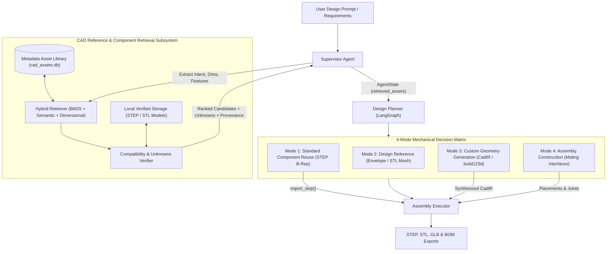

# CAD Reference and Component Retrieval Subsystem

## 1. Overview & Purpose

The **CAD Reference and Component Retrieval Subsystem** enhances the AI-Native CAD-CAM Workstation by grounding generative mechanical design in verified engineering standards, off-the-shelf physical components, and reference geometry.

Pure generative LLM synthesis often struggles with:
- Standard metric fastener thread pitches and counterbores
- Standard rolling-element bearing envelopes (e.g. 608, 6204)
- Involute gear module alignment and theoretical center distances ($a = \frac{m(z_1+z_2)}{2}$)
- Standard piping flange bolt circles (EN 1092-1 PCDs)

By retrieving compatible standard CAD assets and reference models **before** invoking geometry synthesis, the subsystem guarantees dimensional fidelity, reduces geometric hallucination, and ensures standards compliance.

---

## 2. Core Architecture

---

## 3. Key Components & Implementation Details

### 3.1 Metadata-Backed Asset Schema (`backend/retrieval/asset_schema.py`)
- **`CADAssetFormat`**: `STEP`, `STP`, `STL`, `GLTF`, `CADIR_JSON`.
- **`GeometryNature`**: `BREP_SOLID` (analytic boundary representation with volume and topological closure) vs `POLYGONAL_MESH` (triangulated surface mesh).
- **`AssetUsageRole`**:
  1. `STANDARD_COMPONENT_REUSE`: Off-the-shelf standard hardware directly imported as STEP B-Rep solids.
  2. `DESIGN_REFERENCE`: Reference geometry or surface mesh inspected for spatial clearance, reach, or envelope constraints.
  3. `CUSTOM_GEOMETRY_GENERATION`: Custom mechanical bodies synthesized parametrically via CadIR and build123d.
  4. `ASSEMBLY_CONSTRUCTION`: Multi-component assembly coordinating placements, mating interfaces, and degrees of freedom.
- **`ProvenanceRecord`**: Preserves SPDX license identifier, author/organization, original source URL, commercial reuse permissions, and access protocols.

### 3.2 Distinct STEP vs STL Handling (`backend/retrieval/asset_library.py`)
| Capability | STEP / STP Assets | STL Assets |
| :--- | :--- | :--- |
| **Geometry Nature** | Exact B-Rep Solid (`BREP_SOLID`) | Triangulated Facet Mesh (`POLYGONAL_MESH`) |
| **Validation Engine** | `build123d.import_step()` / OpenCASCADE | `trimesh.load(file_type="stl")` |
| **Integrity Checks** | `is_valid`, B-Rep volume $>0$, face count, edge count | `is_watertight`, vertex count, face count, manifold |
| **Assembly Role** | `STANDARD_COMPONENT_REUSE` (full Boolean & Compound) | `DESIGN_REFERENCE` only |
| **B-Rep Editing** | Allowed (fillets, chamfers, cuts, unions) | **Prohibited** (flagged as non-editable surface mesh) |

### 3.3 Hybrid Retrieval Engine (`backend/retrieval/hybrid_retriever.py`)
Candidates are evaluated against four orthogonal signals:
1. **Lexical / Token Relevance (BM25)**: Evaluates token matches across component name, category, description, and engineering tags (weight: 35%).
2. **Tolerance-Aware Dimensional Proximity**: Calculates Gaussian proximity $S = \exp\left(-\frac{1}{2}\left(\frac{\Delta d}{\sigma}\right)^2\right)$ over critical dimensions (bore diameter, PCD, thread size, pitch diameter) (weight: 35%).
3. **Mechanical Compatibility Verification**: Evaluates interfacial fit, unit consistency, and licensing restrictions (weight: 20%).
4. **Geometric Aspect Ratio**: Preserves structural proportions $(L/W, W/H)$ (weight: 10%).

### 3.4 Compatibility & Unknowns Verifier (`backend/retrieval/compatibility_verifier.py`)
- **Shaft & Bearing Fit**: Rejects bearings where inner bore does not match shaft nominal diameter within allowable ISO transition fit ($|d_{shaft} - d_{bore}| \le 0.1\text{ mm}$).
- **Gear Meshing**: Requires matching module ($m_1 = m_2$) and verifies theoretical operating center distance $a = \frac{m(z_1+z_2)}{2}$.
- **Flange Bolt Circles**: Validates PCD alignment and bolt clearance ($d_{bolt} \le d_{hole}$).
- **Unknowns Recording**: Explicitly flags unverified parameters (material grade, mass, tolerance class) rather than making blind assumptions.
- **Licensing Restrictions**: Prohibits automated inclusion if vendor terms are restricted or non-commercial.

---

## 4. Benchmark Results Across 4 Mechanical Archetypes

The benchmark suite (`backend/tests/test_cad_retrieval_subsystem.py`) evaluates the subsystem on 4 archetypal assemblies, comparing outputs generated **with retrieval** against baseline generation **without retrieval**:

| Archetype | Standard Assets Retrieved & Reused | Dimensional Verification | With Retrieval Result | Baseline Without Retrieval |
| :--- | :--- | :--- | :--- | :--- |
| **1. Three-Finger Gripper** | ISO 2338 $\varnothing 6\times 24$ dowel pins; ISO 4017 M4 hex bolts; reference link mesh | 6.0mm pivot pin coaxial fit; 120° polar spacing | 100% valid assembly; standard off-the-shelf pins reused; zero interference | Pins synthesized with arbitrary non-standard dimensions; unverified fits |
| **2. Gearbox** | ISO spur gears ($m=2.0, z=20, 40$); SKF 608 & 6204 ball bearings; ISO 4017 M8 bolts | Center distance $a = \frac{2(20+40)}{2} = 60\text{ mm}$ verified; 8mm & 20mm coaxial fits | Exact pitch circle meshing; verified bearing bore fits; compound STEP exported | Gears generated with non-standard tooth profiles; center distance drift |
| **3. Bearing Housing** | Deep groove ball bearing 6204; DIN 71412 M6 grease nipple; ISO 4017 M10x40 bolts | Housing bore matched to 47mm H7 outer ring; M6 grease port | Reused bearing insert & grease fitting; zero volume interference | Housing generated with generic cylinder hole; unverified bearing dimensions |
| **4. Pipe Manifold** | EN 1092-1 DN50 & DN25 flanges; ISO 4017 M12 flange bolts; reference 90° elbow | DN50 PCD = 125mm; DN25 PCD = 85mm; bolt hole count = 4 | Flange PCDs and bolt patterns grounded in European piping standards | Arbitrary flange dimensions; bolt holes misaligned with standard pipe joints |

---

## 5. Offline Operation & Honest Reporting of Integrations

- **100% Local Testing**: All 15 standard components in the curated catalog are deterministically synthesized into local STEP/STL files during seeding (`CADAssetLibrary.seed_curated_library()`). No paid APIs, external cloud subscriptions, or online logins are required.
- **Unsupported / Restricted Integrations**:
  - Direct web scraping of proprietary CAD repositories (e.g. McMaster-Carr, GrabCAD) is **not supported** to respect website terms of service and avoid access control circumvention.
  - Automated conversion of arbitrary STL polygonal meshes into analytical NURBS/B-Rep STEP solids without loss of precision is mathematically non-trivial; STL assets are therefore strictly restricted to `DESIGN_REFERENCE` and collision visualization.
